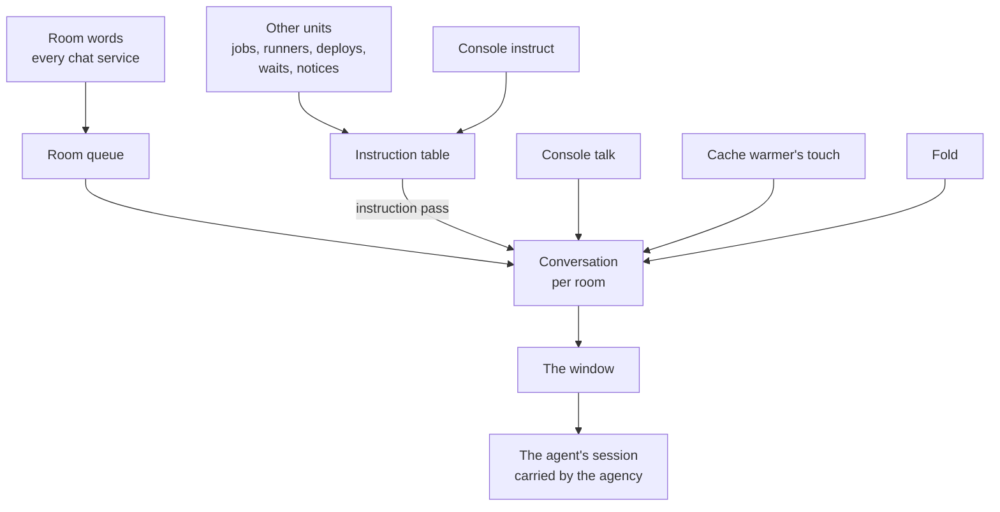
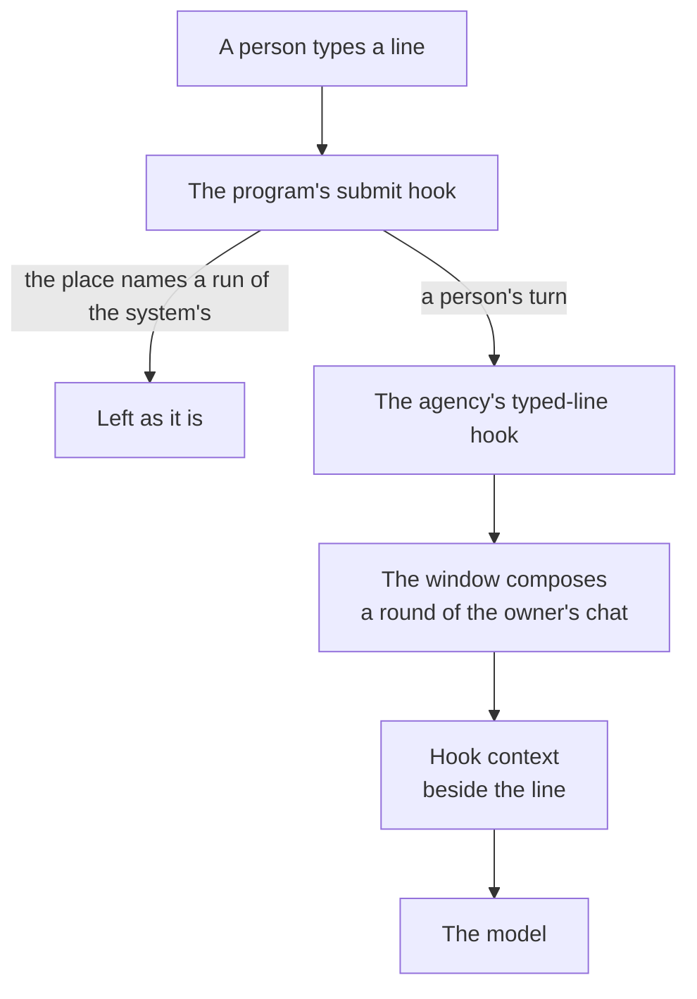

# The one window

Everything that speaks to a supervisor or wakes it reaches the supervisor's chat session through one window. The
window is where every turn is composed, and it hands every turn the same reference a turn of the owner's own
words is handed. There is no second way in.

## The shape

- **The agent's queue** is two lanes and nothing else:
  - a room's words wait in the room queue and then in that room's conversation;
  - everything else waits as a row of the receiver's instruction table: a quiet instruction.
- **The window** is the one place that asks the agent's session for a turn, through the agency's session
  contract, and every turn it asks is composed there.
- **The conversation** decides what a turn answers and when it runs; the window decides what the turn is handed.
  The conversation holds no road of its own to the session.

## The agent's queue

- **A unit that wants the agent's attention queues an instruction.** The agency posts `POST /instructions` for
  the job queue: a job's end, and each change of an item or a job told to the
  supervisor that ordered the work or to the owner (the agency's `docs/agent-control.md`, 「An item's change is
  told to its orderer」); bmo-job's service calls no unit, and its `bmo job ask` queues a job's question for the
  supervisor from the job's own process, and reads the row back while the job waits. A unit that tells the owner
  a fact as a code and its parameters, with no words of its own, reads the owner's private room off `GET /owner`
  and posts `POST /instructions` there, said as a fact, its kind its code. The receiver's own
  producers (its rest and fallback notices, its failure orders, the agency's events) write the row themselves.
  The instruction store is the one writer of the table.
- **One pass delivers the table.** The instruction pass reads the pending rows and hands each to its room's
  conversation; it is the only caller of the conversation's instruct. The console's instruct writes a row and
  brings the pass forward like any other producer.
- **When the pass runs.** On a regular tick of fifteen seconds, at once when a row is queued through a route or
  by the receiver itself, at once each time the agency's event stream opens and when the agency ends a session
  (`docs/wake.md`, 「What the agency's events wake」), and as the receiver starts. Each pass reads every pending
  row afresh.
- **A row may carry events**: what happened, in a form the memories can wait on (「Events」 below). The events
  travel with the row into the turn that takes it.
- **A room's words** reach the conversation from the chat services through the room queue, from the start-up
  backlog, and from the web console's own chat service.
- **A room's words do not wait for the round that is working.** Words the room queue hands over while a turn of
  that room's round works go into that turn at its next look, in one paragraph with any quiet instruction pushed
  with them (「The openings」, `push`), and the agent judges each itself; what no push puts in waits for the
  round's closing check (`docs/instruction.md`, 「What came in meanwhile」).

## Every road into the agent

Each road, where it starts, which lane of the queue it waits in, which opening of the window it takes and
whether it opens a turn of its own. A road not in this table does not exist; a new one is added here before it
is written.

| Road | Starts in | Lane | Opening | Turn | Events |
|---|---|---|---|---|---|
| A room's words, any chat service | the chat service's hand-over | room queue | `round` | opens | — |
| The owner's words from the web console | the console's chat service | room queue | `round` | opens | — |
| Unread words at start-up, every room's | backlog | room queue | `round` | opens | — |
| A quiet instruction arriving while a turn works | instruction pass | instruction table | `push` | joins the working one | the pushed rows' |
| A room's words arriving while a round's turn works | room queue | room queue | `push` | joins the working one, the agent judging each message | — |
| A room's words no push put in: arriving between the round's turns, refused by the turn, or for a turn that takes no words while it works | room queue | room queue | `question` | in the round's closing check (`docs/instruction.md`, 「What came in meanwhile」) | — |
| A job's end and its report, a dead pane's among them | the agency's `POST /instructions` | instruction table | `round` | opens | `job-ended` |
| A change of an item or a job told to the supervisor that ordered it: an item awaiting a launch or an approval, an item its paused queue holds or one no checkout takes, an item moved under its running job or closed by another, a job waiting for a road or a slot, an ended job's item left unclosed, an idle agent, a job's question past its due time or settled on its recommendation because the owner did not answer in time, a job that failed in another room, told in the owner's private room as well | the agency's `POST /instructions` | instruction table | `round` | opens | the item's own, named by its kind (the agency's `docs/agent-control.md`, 「An item's change is told to its orderer」) |
| A job's question for the supervisor to judge — settle it itself, talk it over with the job or put it to the owner — withdrawn once it is settled or put to the owner | `POST /instructions`, from `bmo job ask` in the job's own process | instruction table | `round` | opens | `question-for-supervisor` |
| A question put to the owner that he has not been told of, for the supervisor to put to him, withdrawn once a reply settles it | `POST /instructions`, from `bmo job ask` for a question whose notice to the supervisor was let go untaken, or from the agency for one asked any other way | instruction table | `round` | opens | `question-awaits-answer` |
| A fact a unit tells the owner as a code and its parameters, with no words of its own: a chat service's road standing down, an event of the testbed's | that unit's `POST /instructions` in the owner's private room `GET /owner` names | instruction table | `round` | opens | the unit's own, named by its kind |
| A failure order for a broken chat turn, the default answerer's: in the room the turn broke in where it answers that room, else in the owner's private room naming the agent and the room (`docs/voiced-notices.md`, 「What each path says」) | the conversation's failure check | instruction table | `round` | opens | `failure-order`, and `failure-order:<room>` in the owner's private room for another room's |
| The back-up line after a deployment | start-up | instruction table | `round` | rides, for the restart's while | — |
| The back-up line after a restart no deployment announced | start-up | instruction table | `round` | opens | — |
| The deployment briefing: the deployments since the owner was last briefed, asking the agent to brief him (`docs/wake.md`, 「Quiet instructions」) | the round's start | instruction table | `round` | rides, the owner's next round | — |
| Rest, outage, recovery, downgrade and fallback notices | the agency's events | instruction table | `round` | opens | — |
| A continuation of a round whose turn the agency's restart or the rest cut (「Quiet instruction」) | the round's failure | instruction table | `round` | opens, once the agency answers or the rest lifts | — |
| A document reload | the agency's `document-move.created` | instruction table | `round` | rides, for good | — |
| A deployment gone live, and every way one stops short | the testbed's deployment | instruction table | `round` | opens | `deployed` |
| A tool call `bmo use` ran on its own come to its end: a reminder's moment, a watch's check holding, a long draw (`docs/reminders.md`) | bmo-cli's `use` unit | instruction table | `round` | opens | — |
| A search's, a browse's and a remote browser's result | bmo-artifact's instructions | instruction table | `round` | opens | — |
| An answer relayed back to the room that asked | the receiver's sends, the conversation | instruction table | `round` | opens | — |
| Words handed to the room's supervisor: a send asked outside its own round, or words asked in it for another room (`docs/messages.md`, 「Words handed to the room's supervisor」) | `POST /sends` | instruction table | `round` | opens | — |
| Voice and digest notices | the units that run them | instruction table | `round` | opens | — |
| A run past its clock | the agency's events | instruction table | `round` | opens | — |
| An instruction typed on the console | `POST /owner/instructions` | instruction table | `round` | opens | — |
| A talk from the console about an item or a document | `POST /talks` | — | `talk` | opens | — |
| The keepalive touch | the cache warmer's ping | — | `keepalive` | opens | — |
| The consolidation before a fold: the session asked, tools on, to consolidate its brain and answer the skip (`docs/unified-bmo.md`, 「The brain's consolidation」) | the conversation's fold | — | none: the handover policy's `CONSOLIDATE.` marker with the room's block, composed by no window | opens, waited on before the fold | — |
| A line a person types into the agent's program | the agency's `typed-line` hook | — | none: composed, never asked | the person's own turn of the program | — |
| An instruction stage of the chain, or the closing check, asked inside a round after its message turn (`docs/instruction.md`) | the round itself | — | `question` | inside the round | the round's |

- **The session handover** is not a turn. The note a replaced session leaves rides at the head of whichever
  turn first goes out on the new session, and that turn came through the window like every other: it goes whole,
  the room's messages archived since the agent last answered there with it, up to the archived block's cap
  (「What every turn carries」).
- **Not turns at all:**
  - Another agent's wait come due or memory event never reaches the default answerer: it wakes its own agent
    in its own room.
  - Words in a room the default answerer does not answer, one other agents answer alone, never reach it: the
    receiver wakes those agents and no lane of this queue. A room the owner shares with another agent is a
    room's words like any other, in the first row.
  - The fold itself is a command to the agent's program, not words to the agent. It goes after the consolidation
    turn, and goes whether or not that turn could be carried.
  - A line a person types into the agent's program is that person's turn, which the receiver does not ask for;
    the window only composes what goes with it (「A line typed into the program」 below).
  - The owner's answer to a job's question, taken in his private chat before anybody is woken (「The owner's
    answer to a job's question」 below).

## A message and an instruction

- **What reaches an agent is one of two things, and the window says which.** A **message** is a room's words, sent by
  a person through a chat service: the agent answers it, and its answer is the message that goes back to the room. An
  **instruction** is the system speaking into the agent's own session; nobody sent it, and none of it goes out as words
  a person wrote.
- **An instruction divides.** A **quiet instruction** is a row of the instruction table handed to the chat's own
  session (「Quiet instruction」 below): the system telling that session something without the room hearing it, kept in
  its own block with its publisher and its words. A **system instruction** is a turn the round's or the session's own
  work opens in that session: the audit of the people a message answers, an instruction stage of the chain, the closing check, the agent's first judgement, the
  situation note, a handoff and a consolidation. Each carries a marker naming what it asks, never the shape of a
  person's message, so a screen that shows the turn at all shows an instruction and not a message received.
- **Both kinds of instruction reach the session the rooms' words reach,** hold the round's rules and go through the
  same roads. What differs is what each does with an answer: a stage's answer is the message that goes out, while a
  quiet instruction's, a note's, a judgement's and a consolidation's reach no room.

## The owner's answer to a job's question

- **A question a job put to the owner is answered in his private chat before anybody is woken.** While bmo-job
  holds a question of that chat waiting for him, his words there are read against it first, against the one
  asked last where several wait. What is taken there is no turn: it costs no run, wakes nobody, is taken during a
  rest too, and tells the queue's standing as moved, since the console reads the questions beside the queue.
- **A choice settles it:** a line of one line naming exactly one of its options, by the option's number as it
  stands or with the suffix the policy allows after it, or by a piece of text standing in that option alone.
- **Talk over it is a reply to an agent's words, and nothing else.** A line that chooses nothing is written onto
  the question as talk only where the owner sent it as a reply to a message an agent wrote in that chat, the
  message that put the question to him among them, and only where it carries words; bmo-job stops the question's
  clock on a talk, as its port states. Every other line is an ordinary message, woken on as any words are, so
  words written about something else while a question waits leave its clock running.
- **The port names no message for a question,** so the receiver cannot tell the agent's message that put the
  question apart from the agent's other messages in the chat: a reply to any of them while a question waits is
  talk over the one asked last. A chat service that cannot point a message at another carries no talk at all.
- **A talk the question refuses,** because it is gone, takes no talk or is settled already, leaves the line an
  ordinary message.

## Quiet instruction

A quiet instruction is a row of the instruction table handed to a chat's own session: the system speaking to
that session without the room hearing it.

- **Its own block in the prompt,** marked the way the message blocks are; nobody in the room sent it or sees it.
- **The row keeps its publisher.** A row's `publisher` names the unit or source that published it; a row that
  carries none is named by the first word of its `kind`, and a row that names neither is `the system`
  (`chat-round.toml`, `[instructions]`, `unknown_publisher`). The block opens on that publisher and what the row
  knows of the agent and room it is for (`source`, `agent`, `room`), beside the notice's own words.
- **A repeated notice is one block.** Rows with the same publisher, agent, room and words are carried once.
  Where they name no item, the block says how many arrived (`repeat`); where they name one, its line carries the
  count (`subject_times`). Where the same words come for different items, the words stand once and one line
  names each item with its identifier (`subject`).
- **A notice repeated is queued once.** A row whose agent, room, publisher, kind, sort, events, run and words are
  those of a row still waiting — pending or handed, not yet settled — is not written: the producer is answered
  with the row that waits, which says it once. Nor is one whose like was let go as failed within the instruction
  policy's `repeat_minutes`: a notice no round could take is not handed to the next round to fail again, so a
  producer that tells the same failure on every failed turn does not wake the agent turn after turn.
- **Some are for the agent alone.** A row marked `agent_only` is a record the agent reads and no room hears: a
  round carrying only such rows is a quiet turn whose reply is dropped, and no room message is sent. The tool
  list's notes, a failure order of a broken run, a run past its clock and a document reload are marked so; a
  notice meant for the room is not, and a round carrying one sends its answer as any room notice does. A round
  that also read a room's words answers those words, with the agent-only record read as part of the turn.
- **A row waits for a turn to take it.** A row carries no expiry: it is delivered with the round it is handed
  to, however long it waited, and a newer row of the same kind in the chat replaces one not yet handed.
- **A row moves through one lifecycle, and no row is ever deleted.** It is pending until the pass hands it to a
  room's conversation (`handed_at`). It is carried once a turn holds its text: the round's own turn where the row
  stands in its prompt, or the working turn a push put it into, the turn's session and id written on the row as
  the agency names the turn. It is settled (`delivered_at`, and the round that settled it) only once its round
  ended with its message or its skip, after the turn that carried it ended answered in the session that received
  its text. Every other end returns the row to pending with its carrying cleared: a round that failed, a restart
  of the receiver, a round that ended before any turn carried the row. A row that is not to be carried is let go: kept
  on the table, settled with the reason it went (`let_go`) and no round — a newer row of its kind replaced it,
  its producer withdrew it, no turn could ever take it, a stop asked of its round ended it, a reset cut its agent
  off, or its failures reached the limit.
- **A row carries its cause:** a room reply, which answers something a room or the owner asked and opens its
  turn on a session past its cache lifetime too, or housekeeping, a record for the agent alone that waits there
  for a round something else opens (`docs/wake.md`, 「Quiet instructions」). The producer names it on the row; a
  row marked `agent_only` is housekeeping whatever it names, and a row that names none is a room reply.
- **A round that failed gives back every row it took, whatever its cause, and the words it took.** A row whose
  text a session received before the round failed is marked as handed before (`restarts`), so the turn that takes
  it next opens it under the policy's marker and looks at what is already done before it repeats anything. A
  failure the agency answered — the turn ended failed, a call refused, a step of the receiver's own failing — is
  counted on each row the round took (`failures`), and a row counted the policy's `failure_limit` times is let go
  as `failed` with the round that failed last, whose failure order still stands. A failure where the agency was
  unreachable, cut the turn's connection or holds no record of the turn counts nothing: no row and no word is
  ever let go for it, and the instruction pass holds the agent's rows until the agency answers again.
- **A round whose turn was cut is continued, never ordered.** A turn is cut, not broken, where the agency went
  away under it — the agency unreachable past the re-attachment's while, holding no record of the turn or no end
  of it, or the turn's connection or stream cut while it worked and the turn then ending failed, as a restart or a
  deployment of the agency leaves it, the one the agent started itself among them — or where it failed while the
  rest closes its agent's road. Such a round counts nothing on its rows or its words, raises no failure order, and
  gives back what it took as every failed round does; the receiver then queues a continuation for its agent in the
  room the round ran in (`policy/chat-round.toml`, `[cut]`): its marker, the moment the turn was cut and what cut
  it, and the ask to look at what is already done and carry the work on to its end in that turn. It is a room
  reply under the kind `turn-cut`, so a later cut in the same room replaces one not yet handed, and the pass hands
  it once the agency answers again or the rest lifts, the words and rows the cut round gave back opening the same
  round with it. The round's end is told as `run-cut`, naming what cut it (`docs/api.md`, 「Events and the live board」).
- **A turn refused because its session is in another turn is no failure.** The agency refuses a turn sent to a
  session already working (409); whatever holds the session — a handoff, a replacement, a turn the agency runs of
  its own — the round waits for that turn's end on the agency's event stream, however long it takes, and sends its
  own turn again, counting nothing on its rows or its words. The end of the other turn is never read as the
  round's own: an end heard before the refusal was answered, while the round's turn is still unnamed, is kept
  aside until the send says whose it was. A stop
  asked of a round raises no order at all and lets its rows go as `stopped`. The words a failed round took go
  back to wait the same way and are counted the same way (`docs/messages.md`, 「Read marker」).
- **A turn is a resource the round re-attaches to, never one held call.** The round sends its turn under a key of
  its own (`docs/boundary-api.md`, 「The agency」) and follows the turn's end on the agency's event stream. A look
  that carried no words to the working turn reads the turn at the agency instead, so no end the stream loses
  stands unlearned past one look: a turn read back as ended with its end in the read moves the round on as the
  stream's own end would, and one read as ended with nothing carrying its end, or answered with no record of it,
  cuts the following; a send answered whose turn was never named at all, so no read has a turn to name, is cut
  at the next look likewise, since only the kept events or the turn itself can still say what stands.
  A cut — the stream ending or failing, the send's connection closing, the agency answering words offered to the
  working turn that no such turn is going, or such a read finding the turn gone — is no end of the turn:
  the round opens the
  stream again and reads the events the agency kept since the last one heard before the turn went out, where the
  turn's end, once it came, stands. Where none does it reads the turn: one still running is followed on; one whose
  read carries its end gives it; one read as ended with its end nowhere the round can read, and one the agency
  holds no record of, fail the round, uncounted, so the round runs again rather than settle its rows on an answer
  it never read. A turn the round never heard named,
  and which no kept event names, is sent again under the same key, which the agency attaches to the turn
  standing under it. While
  the agency answers nothing the round keeps asking, and only after the round policy's `reattach_ms` without an
  answer does it fail, uncounted.
- **Acted on as the owner's word in that chat.** The session may skip the instruction in any chat, the owner's
  private chat included, when acting on it needs nothing said; where the instruction rode a round of a room, the
  skip goes in the round's form, which names why (`docs/instruction.md`, 「What it is」). The permission covers the
  instruction and not the
  round it rides in, so where the same round also read the owner's own words in the owner's own chat the silence
  is withdrawn and those words are answered along with the instruction.
- **The two markers are stripped from outgoing text** like every other piece of prompt scaffolding, so neither
  can leak into a message. That cut is made the moment a reply comes back from the session, before any gate
  reads it: a session sometimes writes on past its answer and invents the next prompt, a "New messages" block
  carrying words nobody sent, and a gate that read it would take the invented message for a real one. A reply
  that was nothing but such scaffolding counts as a skip naming no reason, so a round's turn is asked once over it.
- **A chat already talking takes it into that conversation,** and it runs as soon as the reply in flight is
  done; otherwise it opens a conversation of its own, carrying the archived messages since the last reply as an
  ordinary wake would, and consumes nothing: the read marker never moves for it.
- **It never holds a room open.** A skip of an instruction opens no window, and a conversation opened for
  an instruction closes as soon as it is done, so a room is never listened to on an instruction's account; an
  answer to the room's own messages is the one thing that keeps the room open.
- **The pass skips the rows of an agent whose road the usage rest closes,** in every chat, the owner's private
  chat among them, until the rest lifts at its known end or the agency answers that the agent's road takes a turn
  again: a round on that road could only fail, so none of those rows is handed, counted as failed or let go
  meanwhile. It skips the rows of an agent whose last round failed with the agency unreachable until the agency
  answers a read again.
- **Cold wakes are paced.** Handing an instruction to a chat that is not talking resumes its session and
  prefills its whole context again, so a reload that queues one row per room would re-prefill every room at
  once. So the pass lets a cold wake through only when the launch gap has passed since the last one, the same
  launch gap a chat's first runs keep after a restart; a row for a chat that is already talking joins the turn
  in flight and prefills nothing, so it goes at once, and a lone wake in a quiet stretch goes at once too. Only a
  burst is spread out, and while wakes are held back the pass comes round at the gap rather than the full tick,
  so the queue drains one wake at a time.
- **A chat's first run since the receiver started is spaced from every other chat's first run** by the same
  launch gap: each first launch takes the next free moment on one schedule, the gap after the last moment taken,
  and waits for that moment alone. Nothing else waits on the schedule: a run of a chat already launched goes at
  once, and a first launch never holds back another chat's turn while it waits.
- **A job's status notice reaches the item's requester, not the launcher:** it is queued in the requester's
  room, which is the room's answerer first, the requester's private room where the room names no answerer, and
  the default answerer where neither does. The report stands whole on the item, and the requester hears its relay in
  its room. The launcher still gets the queue fact — a worker free, an item's state — in its own room, without
  the report's relay. None of them says what to do. The session reads the queue and the running state and
  chooses, as its procedure for the queue says; it runs another item where the owner tells it to.
- **Each row says what it is, as whoever wrote it puts it.** The producer that queues a row names its sort, a
  short key such as the machine's state, a document update or a watch, which the console words through its
  language pack and shows as the key itself where the pack has no word for it, and may give a one-line summary
  of it; a row with no summary is summed up by its own first line, and a row with no sort stands as a quiet
  instruction and nothing more. The queue keeps no list of sorts: a new producer brings its own key.
- **A row names the round that settled it.** The round that took it, as the row's own or as words pushed into
  its working turn, writes its name on the row as it settles it, which is the name its judgements carry; so the
  console shows on a turn's verdicts the instructions it carried (`GET /rounds/openings`). A row still handed and
  not settled names none yet.

## Rows that ride

A row that nearly always ends in a skip, or that only makes sense beside the row that follows it, does not
open a turn of its own. It waits for the next round its room opens for something else and goes in with that
round.

- **The producer decides, per row.** A row is queued either to open a turn or to ride, and a rider names how
  long it rides (for good, or until a moment after which it opens a turn itself) and whose rounds may carry it:
  its own room's alone, or any room's its session answers. The queue keeps no list of which roads ride; each
  producer says so on the row it writes (`ridesUntil` or `ridesForGood` on the routes that queue one).
- **What rides:**
  - A document reload rides for good, in a round of any room its session answers. The new text is read with the
    session's next turn, which is when it is first needed; a session that never speaks again never needs it. A
    reload still waiting is folded into the next one for its room, so a quiet room carries one row, naming
    every document changed since the last turn.
  - The back-up line after a deployment rides for the restart's while, three minutes, so the deployment's own
    outcome fact, which follows within seconds, opens the one turn and the line goes in with it. A deployment
    that tells no outcome leaves the line to open its own turn when the while is up.
  - A change of the tool host's tools rides for good, in a round of any room the default answerer's session answers
    (`docs/wake.md`, 「Quiet instructions」).
  - A fact of a person's supply the agency tells their own supervisor — a run moved to another source, a key the
    provider refused, no source left — rides for good, in its own room's rounds: while no source is left a turn of
    that supervisor can only fail, so the fact never opens one, and the supervisor reads it at the next round that
    goes out. No source left is not left to that round: its instruction carries the `supply-closed` fixed line,
    which the room hears at once as the service's own, saying why (`docs/voiced-notices.md`, 「Lines that stay
    fixed」).
  - The deployment briefing rides the owner's next round, written just before that round asks for its riders, for
    the restart's while. A round of another room that finds deployments since the last briefing writes the row for
    the owner's chat and does not carry it. Only an agent that answers the owner's chat, as the wake reads who
    answers a room (`docs/wake.md`, 「Who reaches the session」), writes the briefing; a round of an agent that does not,
    a person's own supervisor in their room among them, writes none.
- **What never rides:** anything the owner must not hear late (a job's ending, a failure, a road that moved or
  closed, a question or a stop, a deployment's outcome, a result somebody asked for) and anything that is the machine's only wake for work to
  move: an item awaiting its launch or its approval, a job waiting for a road or a slot. Those turns often do their work in tool
  calls and say nothing, so a skip there is not an idle turn.
- **How a rider gets in.** The instruction pass hands a rider over at the start of a round that may carry it
  (the round asks the pass for its riders before it takes anything) and never on its own tick while the rider
  still rides. A rider past its while is handed like any other row.
- **Owner-only lines keep to the owner's room.** The restart's back line and the deployment
  briefing ride only the owner's own rounds, since a line for the owner said in a group room is said to the
  wrong people.
- **What stays the same for a rider:** it is still a row of the instruction table, it carries its events like any
  row, it waits until a round takes it, and it is settled with the round that took it.
- **A rider is not waiting behind a turn.** Only a row that would open a turn waits behind one, and no turn
  counts those rows now: the room's block states the agent's queue choice once.

## What every turn carries

Every opening is composed the same way, whatever brought it. The receiver hands the gate the turn's envelope
(`POST /reference/selected`, `docs/boundary-api.md`, 「The gate」) and puts in the turn what the gate answers;
which of the brain's material that is, is the gate's decision alone (the gate's `docs/reference-selection.md`).

- **What the receiver hands the gate:**
  - the room, and the message the turn stands under;
  - the turn's lines: the room's new words, each as its sender and text, each quiet instruction's text as a
    line of the agent's own, and the words of a console talk. A turn with no line at all hands none;
  - the numbers of the people who spoke this turn;
  - the situation: the turn's agent, the room's kind, the events the turn carries and the moment it is asked;
  - the room's audience for the turn's agent, whether anyone outside the company of its owner sits there
    (`docs/receiver.md`, 「Whether someone outside the company sits in a room」), read only where the agent's brain
    and reference are on;
  - for what a round puts into its turns after its own — a push, or the words a later question carries — what
    the round already holds, so nothing it carries is handed again (「The openings」 below), and the round the
    turn belongs to;
  - whether anybody spoke: one test, kept beside the turn's shape: a message of anyone but the agent, or words
    handed in from the console. A turn it answers no to brought the system's own lines alone: a notice turn;
  - what the turn answered already, where it is asked again, the gates switched off for the agent, and whether
    the turn's road records its gates.
- **What the gate decides:** the entries the turn carries, all of the turn's agent's own and of rows marked for
  every agent, never another agent's. Nothing of a room attaches for standing there, and no gate picks: the gate
  answers what attaches without a pick — the head of the standing sheet of each person who spoke, the room's due
  memories, the errands whose event has come, at most three, and the rows the turn's events wake. The room's
  rules, its other memories and the brain's references are no turn's to be handed; the agent reads them through
  the index. A turn with no line at all still carries what attaches.

**A supervisor whose brain or reference is off asks the gate for no core.** Its turns carry no entry the gate
would attach, and its room's block no index, hint or due line, nor the block's rules about the index; a person's own
thread still goes in (`docs/instruction.md`, 「A supervisor whose brain or reference is off」). Everything below holds
for a supervisor whose brain and reference are both on, which every supervisor is unless its settings say
otherwise.

**What the gate answers is the turn's core and goes in whole.** Each entry goes to the session in full once per
version, then as a mark naming it while the session holds that version, in one reference block with a person's
own thread.

The brain's index is not carried by a turn. It rides the room's block, the session's system prompt, when the
block goes in full — the session's opening on that room — and the agent reads anything more it needs itself:

- **One line, once** — the system documents, the room's rules, knowledge, the people the brain knows, the
  room's memories and the organisation's, the memories of the units the agent's owner stands in beyond the org
  sheet a turn carries, each with how many entries of it the session had not read when it opened and, where the
  gate gives one, what changed in it lately (`chat-round.toml`, `[index]`). An entry the session holds at its
  version, by the agency's record of the session's loads (`GET /session-loads/{sessionId}`), is read and counted
  out.
- **Then one hint, never an order:** look one up only when the answer needs it, and otherwise just
  answer. It closes the index the opening block carries. Whether the agent reads is its own choice, and nothing
  counts or holds it to having read. The only hard rule stands in the instruction pipeline's `facts` question: nothing
  unread is spoken of as fact.
- **Then the due line, where the brain said a consolidation was due at that opening.** The receiver asks the
  agent's brain whether one is (`docs/boundary-api.md`, 「The brain」), and where it answers `consolidationDue`
  true the line stands after the hint (`chat-round.toml`, `[index]`, `due`). The room's block also carries the
  standing rule that the `memory` question consolidates when the brain has unconsolidated episodes
  (`docs/instruction.md`, 「The stage chain and its texts」); a brain that does not answer, or answers false, carries no due line.
- **The counts are the gate's** (`GET /reference/index`, `docs/boundary-api.md`, 「The gate」): its `unread`, what
  the session's loads do not hold, and its `hint`, one line of what changed in the last three days. A piece the
  session already loaded is counted out of its group. Where the gate serves no index, the hint and the due line
  stand with no group counted.
- **No walk rides a turn.** A new session opens on its handoff note and then the room's block, whose own-room
  index is the only one that turn carries; each later room's opening block carries that room's index in turn.
- **A person's own thread** from the group rooms they share with the agent, handed to a turn in their private
  room (`docs/unified-bmo.md`), is the receiver's own words of rooms rather than the brain's. It is handed whole
  the first time and then only the lines added since the last line it handed, under the same path and a heading
  saying so; a turn with no new line attaches nothing and the pipeline record lists the piece as `held`. The mark is
  the thread's own, kept under `thread_mark:<path>` in the settings: a session folded, replaced or started again
  is handed only what came after it, within the days the thread reaches, so the raw lines a session has already
  read are never handed to the next one again.
- **A turn's material is handed once.** The round's first turn carries the core's documents and references and
  the room's words whole; a later round of the same turn carries each as a line and only what is new whole, under
  the turn's own mark (`docs/instruction.md`, 「The turn's mark」).
- **The room's situation** is the receiver's own note, one row a room (`docs/instruction.md`, 「The situation note」):
  it is written when the session leaves the room, before a handoff and on a touch, and the round that first takes
  a session into the room reads it, in its judgement turn or at the head of its message turn, ahead of the room's
  words. It is no reference document,
  it stands nowhere in the core, and it is not a brain memory. A session reads a room's note once: a round
  carries it only where the session holds none of that room, which is its first round there since it opened,
  folded or was handed over. The turn that updates a note carries the note whole where the session has not read
  that version and otherwise the policy's one-line marker that it is unchanged
  (`chat-round.toml`, `[situation]`, `unchanged`); what a session holds is kept under `bmo_session_notes`
  (`docs/store.md`).
- **The memories entry carries data alone.** How it is read stands in the room's block (`chat-round.toml`,
  `[index]`, `memories`): that these are the agent's own quiet memory, never recited and never brought up unless
  someone asks, acted on when their time comes; how an item is checked off with `memory_done`; and how a state is
  moved with `memory_update`, or released when it ends. The entry itself carries only its head, its rows and the
  line on those not carried.
- **The block stands after the turn's words and instructions,** ahead of the round's marker, so a session reads
  what came in before it decides whether to look anything up. The turn carries no closing lines: the closing
  rules, the queue rule and the brain's rule stand in the room's block.

Beside the reference, a turn carries the room's messages the agent has not read:

- **A turn that opens or returns carries everything since the agent last answered there:** the archived block
  rides the turn that opens a session holding nothing (a handover, whether the session was replaced or the
  agency opened it fresh) and the first turn in a room the agent's one session has not answered in (a return),
  with every message after the room's read marker.
- **An ordinary round carries what its session was never handed:** its session holds every message a turn put
  into it, so the block carries only the messages after the room's read marker that no turn handed it — words
  that called nobody, said in a group room before someone called the agent — leaving the agent's own out. A
  round with none such carries no block. The words that arrived after its message turn went out and no push put
  in still stand in the closing check (`docs/instruction.md`, 「What came in meanwhile」).
- **At most a set number of them:** the archived block carries the newest unread messages in their order, as
  many as the chat round's policy sets (`archived_messages`, 100 by default). Where more were unread, the block
  says in one line how many older ones it left out and that they stand in the room's archive, where the agent's
  own tools read them; the turn's scope names only the messages the block carries.
- **A job's report is not among them.** It is no message of any room: the agent is handed it with the job's
  ending and tells the requester in its own words, so what a later turn reads of it is the agent's own answer in
  its session (`docs/voiced-notices.md`, 「A job's end」).

## The openings

- **`round`**: a room's words, its quiet instructions, or both. The window selects over the batch and the
  instructions, with the instructions' events.
- **`push`**: what came for the room while a turn of its round works, put into that turn at its next look, where
  the agent's program takes it between tool calls.
  - **What it carries.** The room's words the room queue handed over since the turn went out, and the quiet
    instructions delivered meanwhile, in one paragraph: the short marker that names the push, what arrived as
    data, the messages as a round's block renders them, each with its sender, its words and its number, the
    numbers named as added to the turn's scope, then the instructions in their own block. A push that carries
    quiet instructions and none of the room's words adds one line to its opening (`kept`): the message written
    before it stands and goes out unless the turn writes a new one, so writing nothing keeps it. No other
    instruction sentence stands in it: what the marker means stands in the room's block. No piece goes in with it: the
    brain's index went in with the room's block at session opening.
  - **Only this room's words.** The push takes its messages from the room's own conversation, keyed by its chat
    id, and its quiet instructions from that same room's rows: another room's message or instruction never joins
    it, and the block names only this room's own message numbers. A test pins this isolation.
  - **Which turns take it.** The round's own turn, its message turn, takes the room's words and the quiet
    instructions. The closing check and the instruction stages take no
    push, and words that come while they work wait (`docs/instruction.md`, 「What came in meanwhile」).
  - **Only while the turn works.** The round looks at its working turn every `look_ms` (`chat-round.toml`,
    `[pushing]`), and offers nothing for `refused_gap_ms` after the agency refused a push. The agency decides
    twice whether the turn still works and puts the words in only where the turn's provider declares that it
    takes words mid-turn; a provider that does not answers every push refused, and its words wait for the
    closing check. A push that went in is waited on, bounded, until the session's record holds it.
  - **The round's privilege holds.** The room's words go in only where they keep the round's standing, read as
    the closing check reads it (`docs/instruction.md`, 「What came in meanwhile」); the others wait and open the
    round after.
  - **The judgement is the agent's.** The room's block says, for the marker, that the words arrived while this
    answer was being made and that each is judged on its own: a message that asks something new or changes what was asked is answered in
    the reply being made, a cancellation or a correction heeded at once, the work it cancels stopped and the
    reply saying so; a message that needs an answer of its own that does not fit this reply is held with
    `<<SEPARATE #<number>>>`; a message that only continues or restates what this reply already answers is set
    aside with `<<DONE #<number>>>`. The block also says that what is written after the marker replaces the
    reply written before it, so a reply that changes is written whole after it, and that writing nothing after
    it keeps the reply written before it, as it does in every round where a message stands
    (`docs/instruction.md`, 「What it is」).
  - **How the round settles each pushed message.** A pushed message is shown to the round as one in the closing
    check is, and the round settles it by the marks its answers set (`docs/instruction.md`, 「What came in
    meanwhile」): one marked neither way is the round's own, answered or heeded by its message, the read mark
    moving to it and the owner's words among it owed an answer; one held goes back to the front of what waits
    once the round's message is made and opens the round after as the room's question; one set aside is read,
    the read mark moving past it, and nothing is sent for it or owed it. A turn that writes no mark takes every
    message pushed into it. A turn whose run failed, or a round that is stopped, gives its pushed messages back to
    wait; a round's own turn that answers `<<WAIT>>` keeps them among the words it waits with.
  - **How the round settles each pushed instruction.** An instruction pushed into the round's own turn joins the
    rows the round took and is settled with the round, under its name.
  - **What the agency answers.** Words it answers `delivered` are the round's from then on; words it answers
    `waiting` or `refused` go back to the front of what waits, and a `waiting` turn is offered nothing more
    (`docs/boundary-api.md`, 「The agency」). Until the agency answers, the words a push took stand with the
    working turn rather than with the push alone, so an agent's reset reaches them: a cut-off heard meanwhile
    lets them go unread with everything else waiting for the agent (`docs/wake.md`, 「An agent's reset」), a push
    it overtook before it went out does not go out, and whatever the agency answers one already sent, nothing
    of it joins the round or goes back to wait.
- **`question`**: a system instruction inside the same round (`docs/instruction.md`): an instruction stage of the
  chain, or the closing check. The message turn itself rides the round's own turn. It carries its marker and its data
  — for a stage the stage's own words, for the closing check the room's words that came in meanwhile, and never the
  message, which is the session's own last one — and no reference of its own: the core went in with the round's turn
  and the brain's index with the room's block at session opening. The closing check, once the
  message stands, carries the room's words that came in meanwhile and no push put in as one block.
- **`talk`**: one turn of a console talk. The window selects over what the owner said and the subject.
- **`keepalive`**: the touch that keeps the prefix warm while nothing is happening. Where a room is owed its
  situation note, the touch is that note's update turn, one a room (`docs/instruction.md`, 「The situation note」).
  Where none is, it is composed like any turn,
  so a row that has come due while the room was quiet is in front of the agent, and it carries the keepalive
  prompt alone. Its answer goes to no room.

## The touch

- **The cache warmer pings the chat touch** (`docs/boundary-api.md`, 「The cache warmer」): a quiet room's
  session touched before its cached prefix cools, so its next word is answered from a warm cache.
- **The touch is a turn of the room the session last stood in,** opened as `keepalive` with the keepalive
  prompt.
- **A touch writes the notes the session owes.** Where the agent answered in rooms whose situation note has not
  been updated since (`docs/instruction.md`, 「The situation note」), the touch updates each room's note with one
  turn of the session, in that room, and those turns are what keeps the prefix warm: the keepalive prompt
  goes in only where no room is owed a note. The touch answers `warmed` where a turn of either kind went in.
- **It is never beside another turn:** while any room is in a conversation or a compaction it answers `busy`;
  while the default answerer keeps a session per room, or its provider is off, resting or down, it answers `skipped`.
- **Every turn of the session reports its use** to the warmer, so a session in use is never pinged.
- **A session past its cache lifetime is not touched:** once its last turn is older than the lifetime its provider
  declares (`providers.toml`, `cache_minutes`, else `keepalive_idle_minutes`), waking it would pay its whole prefix again for nothing, so
  the touch answers `skipped` with `expired`, no fold is started for it, and no housekeeping instruction opens a
  turn of its own on it (`docs/wake.md`, 「Quiet instructions」). It stays as it stands; the next round a room's own
  words or a room reply open replaces it through the handoff (`docs/unified-bmo.md`, 「Replacing the session」).

## A line typed into the program

- **What it is:** a line a person types into the program standing in the default answerer's pane, rather than words
  the system puts in. It holds on whichever road the program is on.
- **Whose it is:** the owner's. The line carries no sender, and only the owner reaches the agent's program, so
  it is composed as the owner's: the owner's id with the owner mark, with the privilege of the owner's own
  room.
- **Which room:** the owner's private chat, the room a console talk runs as. The session is the program's own,
  which the reference documents and the room's block are settled against.
- **What it is handed:** what a round of the owner's private chat would carry for one new message of the
  owner's, made by the round's own prompt builder and the window's own selection, then opened the way a round's
  run is opened on its way out:
  - the reference selected over the line, each document in full or as a mark as the session holds it, and the
    room's block where the session does not hold it;
  - the turn scope and the line itself as the one new message; the closing rules, the queue rule, the
    brain's rule and the memories rule stand in the room's block;
  - headed by a marker and, as data, the line saying the owner typed it into the program and that its number
    `#0` is no message of the archive; the rule the marker stands for — that the answer is read on that screen
    and goes to no room, and that a composition the program keeps in a file is read whole before answering —
    stands in the room's block.
- **How it reaches the model:** the agency asks the `typed-line` hook with the line and the session, and the
  program puts the composition beside the line as the hook's added context; the model reads the line as typed
  and the composition carrying it, never the composition alone.
- **Once for each typed line:** the hook runs when a prompt is submitted and at no other time, and the context
  is written into the session's record with the line, so it is never composed twice and the prefix cache holds.
  What went in full is recorded against the session, as a round's run records it, so the next round sends those
  documents as marks.
- **What is left alone:** a prompt submitted while the agent's place names a run of the system's (every round,
  fold and touch the system puts in, which carries its own composition), a word the system pushed into its
  round that the program took only after the turn had ended, a slash command, and every other agent's program:
  only the default answerer's typed lines are composed.
- **Its size:** the program hands the model a hook's context whole up to 10,000 characters; a longer one it
  saves to a file beside the session and hands over the path and the first 2 KB, so the model reads the rest
  with a tool call.
- **What does not follow:** the answer stays on the program's screen. Nothing the receiver does with a round's
  answer reaches it (the output gates, the instruction pipeline, formatting, sending to a room) and
  the line is not archived.
- **When the receiver cannot compose it** (down, failing, or slower than the hook's bound) the hook answers no
  context and the line goes on as typed.

## Document reload

- **The agency publishes `document-move.created`** when a reload names documents. The receiver tells the sessions it
  concerns by a riding instruction for each room, folded into the one still waiting there, which rides for good
  in a round of any room the session answers.
  - Where the event names rooms, the named agent's sessions in those rooms are told, the default answerer's where it
    names no agent, and only the rooms holding a session of that agent. A reload that names an agent and rooms is
    the brain's, so a relative path it names stands under the brain root (`docs/boundary-api.md`,
    「Configuration」).
  - Where it names none, each document concerns the default answerer's sessions it reads in: a room's own documents
    that room's, a person's the rooms they speak in, the shared ones every session; a document of a session's own
    system prompt, or of its turn, is read with its next turn and told to nobody.
- **A chat told within the last hour** gets the documents with its next reload; one whose reload says `now` is
  told at once. Which rooms were told when is the receiver's record (its reload tables), kept for the default answerer's
  sessions; another agent's session is told at once, folded into its own row still waiting in the room.

## Events

- **An event is a fact of the machine** that a memory can wait on, where a condition would ask a model to guess
  it. Three kinds:
  - `deployed:<item>`: the deployment carrying item `#<item>` went live.
  - `job-ended:<item>`: a job of item `#<item>` ended, however it ended.
  - `queue-changed`: the queue changed in a way the agent is told of: a worker standing open with work waiting,
    the queue told again, a row raised.
- **A row's event names a kind, with or without an item.** `deployed` waits for any deployment, `deployed:773`
  for the one carrying #773.
- **The producer names the event,** on the instruction it queues, from what it knows.
- **An event is met where it passes the window.** Once a turn carries it, the gate hands the rows waiting on it:
  an errand stands from then on until it is checked off, and a situation row attaches on that turn and waits for
  its event again.

## Timing is the agent's

- **The agent chooses when to answer.** The room's block states the choice once: answer now, or answer
  `<<WAIT>>` to take the next words in. A turn no longer counts what
  waits behind it.
- **No content judgement stands between the agent and any room.** A round sends what the agent wrote at the end
  of its pipeline, held only to the code's own items and checks below and the words' form.
- **The instruction pipeline asks the agent its questions** (`docs/instruction.md`): the round's turn names the first
  round, each question's own text stands in the room's block, the agent establishes what the message needs
  before it writes it, and what it answers is its own; no model judges the answer.
- **What checks a message before it goes out is the supervisor's chain of instruction stages** (`docs/instruction.md`,
  「The stages before the send」): a system instruction a stage, each answered with the message reprinted or nothing,
  and the checks that stay in code are the ones `docs/answer-checks.md` names.

## What keeps the window the only way in

The tests fail when any of these breaks:

- Nothing but the window asks the agency for a turn of the agent's session.
- Nothing but the instruction pass hands a row to a conversation.
- Nothing but the instruction store writes the instruction table.
- The window asks only with a selection it made itself: an opening cannot be sent without one.
- Every opening the window knows is a row of the table above, and each is checked to carry the room's standing
  memory.
