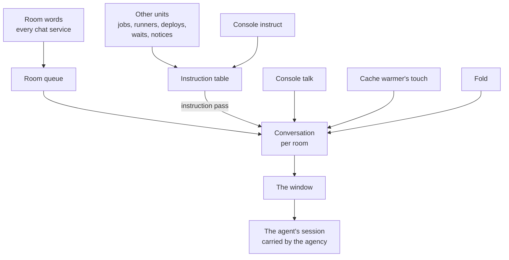
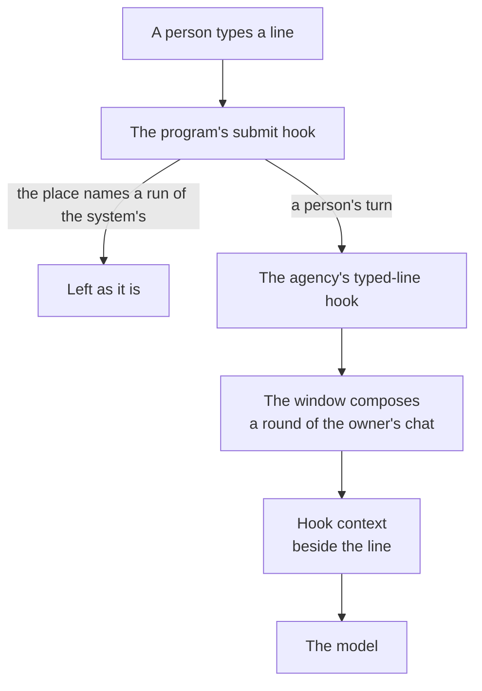

# The one window

Everything that speaks to the chat agent or wakes it reaches the agent's chat session through one window. The
window is where every turn is composed, and it hands every turn the same reference a turn of the owner's own
words is handed. There is no second way in.

## The shape

- **The agent's queue** is two lanes and nothing else:
  - a room's words wait in the room queue and then in that room's conversation;
  - everything else waits as a row of the receiver's instruction table: a quiet instruction.
- **The window** is the one place that asks the agent's session for a turn, through the agency's session
  contract, and every turn it asks is composed there.
- **The conversation** decides what a turn answers and when it runs; the window decides what the turn is handed.
  The conversation holds no road of its own to the session.

## The agent's queue

- **A unit that wants the agent's attention queues an instruction.** bmo-job posts `POST /owner/instructionsions` and
  `POST /rooms/{roomId}/notices`, bmo-artifact `POST /owner/instructionsions` for a run's ending, and the receiver's own producers (its rest, fallback and
  failure notices, its fold, the agency's events) write the row themselves. The instruction store is the one
  writer of the table.
- **One pass delivers the table.** The instruction pass reads the pending rows and hands each to its room's
  conversation; it is the only caller of the conversation's instruct. The console's instruct writes a row and
  brings the pass forward like any other producer.
- **When the pass runs.** On a regular tick of fifteen seconds, at once when a row is queued through a route or
  by the receiver itself, at once each time the agency's event stream opens and when the agency ends a session
  (`docs/wake.md`, 「What the agency's events wake」), and as the receiver starts. Each pass reads every pending
  row afresh.
- **A row may carry events**: what happened, in a form the memories can wait on (「Events」 below). The events
  travel with the row into the turn that takes it.
- **A room's words** reach the conversation from the chat services through the room queue, from the start-up
  backlog, and from the web console's own chat service.
- **A room's words do not wait for the round that is working.** Words the room queue hands over while a turn of
  that room's round works go into that turn at its next look, in one paragraph with any quiet instruction pushed
  with them (「The openings」, `push`), and the agent judges each itself; what no push puts in waits for the
  round's next question (`docs/drafting.md`, 「What came in meanwhile」).

## Every road into the agent

Each road, where it starts, which lane of the queue it waits in, which opening of the window it takes and
whether it opens a turn of its own. A road not in this table does not exist; a new one is added here before it
is written.

| Road | Starts in | Lane | Opening | Turn | Events |
|---|---|---|---|---|---|
| A room's words, any chat service | the chat service's hand-over | room queue | `round` | opens | — |
| The owner's words from the web console | the console's chat service | room queue | `round` | opens | — |
| Unread words at start-up, every room's | backlog | room queue | `round` | opens | — |
| A quiet instruction arriving while a turn works | instruction pass | instruction table | `push` | joins the working one | the pushed rows' |
| A room's words arriving while a round's turn works | room queue | room queue | `push` | joins the working one, the agent judging each message | — |
| A room's words no push put in: arriving between the round's turns, refused by the turn, or for a turn that takes no words while it works | room queue | room queue | `question` | under the round's next question or its closing check (`docs/drafting.md`, 「What came in meanwhile」) | — |
| A job's ending, its report and state facts | bmo-job | instruction table | `round` | opens | `job-ended` |
| A work order's held, resuming, stalled, stopped and paused stages | bmo-job | instruction table | `round` | opens | — |
| A job quiet for five minutes | bmo-job | instruction table | `round` | opens | — |
| A worker standing empty with work waiting for five minutes | bmo-job | instruction table | `round` | opens | `queue-changed` |
| The queue standing open after a pause or a deploy hold | bmo-job | instruction table | `round` | opens | `queue-changed` |
| The queue standing open at start-up | bmo-job | instruction table | `round` | rides, for the restart's while | `queue-changed` |
| A row a job raised | bmo-job | instruction table | `round` | opens | `queue-changed` |
| A dead job's notice and its failure order | bmo-job | instruction table | `round` | opens | `job-ended` on the notice |
| A failure order for a broken run of the agent's own | the conversation's failure check | instruction table | `round` | opens | — |
| An unfinished note's strands handed to the agent | bmo-job | instruction table | `round` | opens | — |
| A deployment gone live, and every way one stops short | bmo-job | instruction table | `round` | opens | `deployed` |
| The back-up line after a deployment | start-up | instruction table | `round` | rides, for the restart's while | — |
| The back-up line after a restart no deployment announced | start-up | instruction table | `round` | opens | — |
| The deployment briefing: the deployments since the owner was last briefed, asking the agent to brief him (`docs/wake.md`, 「Quiet instructions」) | the round's start | instruction table | `round` | rides, the owner's next round | — |
| The line after a fold | the conversation's fold | instruction table | `round` | opens | — |
| Rest, outage, recovery, downgrade and fallback notices | the agency's events | instruction table | `round` | opens | — |
| A document reload | the agency's `document-move.created` | instruction table | `round` | rides, for good | — |
| A tool call `bmo use` ran on its own come to its end: a reminder's moment, a watch's check holding, a long draw (`docs/reminders.md`) | bmo-cli's `use` unit | instruction table | `round` | opens | — |
| A search's, a browse's and a remote browser's result | bmo-artifact's instructions | instruction table | `round` | opens | — |
| A say run's report, and an answer relayed back to the room that asked | the receiver's sends, the conversation | instruction table | `round` | opens | — |
| Words handed to the room's supervisor: a send asked outside its own round (`docs/messages.md`, 「Words handed to the room's supervisor」) | `POST /sends`, `POST /consult-lines` | instruction table | `round` | opens | — |
| Voice and digest notices | the units that run them | instruction table | `round` | opens | — |
| A run past its clock | the agency's events | instruction table | `round` | opens | — |
| An instruction typed on the console | `POST /owner/instructions` | instruction table | `round` | opens | — |
| A talk from the console about an item or a document | `POST /talks` | — | `talk` | opens | — |
| The keepalive touch | the cache warmer's ping | — | `keepalive` | opens | — |
| The words before a fold | the conversation's fold | — | `nap` | opens | — |
| A line a person types into the agent's program | the agency's `typed-line` hook | — | none: composed, never asked | the person's own turn of the program | — |
| A later turn of the draft process inside a round, after the round's own turn that carries its first question: a question, an item (an owed answer, a promise to record, a promise to be woken for, a rule to file) or a check on the final text (`docs/drafting.md`) | the round itself | — | `question` | inside the round | the round's |

- **The session handover** is not a turn. The note a replaced session leaves rides at the head of whichever
  turn first goes out on the new session, and that turn came through the window like every other: it goes whole,
  the room's messages archived since the agent last answered there with it, up to the archived block's cap
  (「What every turn carries」).
- **Not turns at all:**
  - Another agent's wait come due or memory event never reaches the chat agent: it wakes its own agent
    in its own room.
  - Words in a room the chat agent does not answer, one other agents answer alone, never reach it: the
    receiver wakes those agents and no lane of this queue. A room the owner shares with another agent is a
    room's words like any other, in the first row.
  - A job's question is posted in the owner's chat as the agent's message and waits for the owner's answer; the
    agent's session is not asked.
  - The fold itself is a command to the agent's program, not words to the agent.
  - A line a person types into the agent's program is that person's turn, which the receiver does not ask for;
    the window only composes what goes with it (「A line typed into the program」 below).

## Quiet instruction

A quiet instruction is a row of the instruction table handed to a chat's own session: the system speaking to
that session without the room hearing it.

- **Its own block in the prompt,** marked the way the message blocks are; nobody in the room sent it or sees it.
- **Some are for the agent alone.** A row marked `agent_only` is a record the agent reads and no room hears: a
  round carrying only such rows is a quiet turn whose reply is dropped, and no room message is sent. The tool
  list's notes, a failure order of a broken run, a run past its clock and a document reload are marked so; a
  notice meant for the room is not, and a round carrying one sends its answer as any room notice does. A round
  that also read a room's words answers those words, with the agent-only record read as part of the turn.
- **A row waits for a turn to take it.** A row carries no expiry: it is delivered with the round it is handed
  to, however long it waited, and a newer row of the same kind in the chat replaces one not yet handed.
- **A row carries its cause:** a room reply, which answers something a room or the owner asked and opens its
  turn on a session past its cache lifetime too, or housekeeping, a record for the agent alone that waits there
  for a round something else opens (`docs/wake.md`, 「Quiet instructions」). The producer names it on the row; a
  row marked `agent_only` is housekeeping whatever it names, and a row that names none is a room reply.
- **A round settles the rows it took however it ended, except a room reply in a round that failed.** A round
  that failed for any reason but a stop asked of it gives its room replies back to pending, counting the failure
  on the row as a restart is counted, so the next pass hands them again; a reply given back the policy's
  `restart_limit` times is settled with the round that failed last, whose failure notice and order still stand.
  A round whose turn's end never reached it, because the agency's event stream ended first, reads the turn's
  end from the agency; where the agency no longer holds the turn the round has failed.
- **Acted on as the owner's word in that chat.** The session may answer `<<SKIP>>` in any chat, the owner's
  private chat included, when acting on it needs nothing said. The permission covers the instruction and not the
  round it rides in, so where the same round also read the owner's own words in the owner's own chat the silence
  is withdrawn and those words are answered along with the instruction.
- **The two markers are stripped from outgoing text** like every other piece of prompt scaffolding, so neither
  can leak into a message. That cut is made the moment a reply comes back from the session, before any gate
  reads it: a session sometimes writes on past its answer and invents the next prompt, a "New messages" block
  carrying words nobody sent, and a gate that read it would take the invented message for a real one. A reply
  that was nothing but such scaffolding counts as `<<SKIP>>`.
- **A chat already talking takes it into that conversation,** and it runs as soon as the reply in flight is
  done; otherwise it opens a conversation of its own, carrying the archived messages since the last reply as an
  ordinary wake would, and consumes nothing: the read marker never moves for it.
- **It never holds a room open.** A `<<SKIP>>` to an instruction opens no window, and a conversation opened for
  an instruction closes as soon as it is done, so a room is never listened to on an instruction's account; an
  answer to the room's own messages is the one thing that keeps the room open.
- **The pass skips rows for a chat the usage rest has silenced** until the rest lifts. A row is marked handed
  the moment it is handed over and delivered when the round that took it settles it.
- **Cold wakes are paced.** Handing an instruction to a chat that is not talking resumes its session and
  prefills its whole context again, so a reload that queues one row per room would re-prefill every room at
  once. So the pass lets a cold wake through only when the launch gap has passed since the last one, the same
  launch gap a chat's first runs keep after a restart; a row for a chat that is already talking joins the turn
  in flight and prefills nothing, so it goes at once, and a lone wake in a quiet stretch goes at once too. Only a
  burst is spread out, and while wakes are held back the pass comes round at the gap rather than the full tick,
  so the queue drains one wake at a time.
- **A chat's first run since the receiver started is spaced from every other chat's first run** by the same
  launch gap: each first launch takes the next free moment on one schedule, the gap after the last moment taken,
  and waits for that moment alone. Nothing else waits on the schedule: a run of a chat already launched goes at
  once, and a first launch never holds back another chat's turn while it waits.
- **A job's status notice reaches the item's requester, not the launcher:** it is queued in the requester's
  room, which is the room's answerer first, the requester's private room where the room names no answerer, and
  the chat agent where neither does. The report stands whole on the item, and the requester hears its relay in
  its room. The launcher still gets the queue fact — a worker free, an item's state — in its own room, without
  the report's relay. None of them says what to do. The session reads the queue and the running state and
  chooses, as its procedure for the queue says; it runs another item where the owner tells it to.
- **Each row says what it is, as whoever wrote it puts it.** The producer that queues a row names its sort, a
  short key such as the machine's state, a document update or a watch, which the console words through its
  language pack and shows as the key itself where the pack has no word for it, and may give a one-line summary
  of it; a row with no summary is summed up by its own first line, and a row with no sort stands as a quiet
  instruction and nothing more. The queue keeps no list of sorts: a new producer brings its own key.
- **A row names the round that settled it.** The round that took it, as the row's own or as words pushed into
  its working turn, writes its name on the row as it settles it, which is the name its judgements carry; so the
  console shows on a turn's verdicts the instructions it carried (`GET /rounds/openings`). A row still handed and
  not settled names none yet.

## Rows that ride

A row that nearly always ends in `<<SKIP>>`, or that only makes sense beside the row that follows it, does not
open a turn of its own. It waits for the next round its room opens for something else and goes in with that
round.

- **The producer decides, per row.** A row is queued either to open a turn or to ride, and a rider names how
  long it rides (for good, or until a moment after which it opens a turn itself) and whose rounds may carry it:
  its own room's alone, or any room's its session answers. The queue keeps no list of which roads ride; each
  producer says so on the row it writes (`rides_until` on bmo-job's instructions).
- **What rides:**
  - A document reload rides for good, in a round of any room its session answers. The new text is read with the
    session's next turn, which is when it is first needed; a session that never speaks again never needs it. A
    reload still waiting is folded into the next one for its room, so a quiet room carries one row, naming
    every document changed since the last turn.
  - The back-up line after a deployment rides for the restart's while, three minutes, so the deployment's own
    outcome fact, which follows within seconds, opens the one turn and the line goes in with it. A deployment
    that tells no outcome leaves the line to open its own turn when the while is up.
  - The queue standing open at start-up rides for the same while, into the same turn.
  - A change of the tool host's tools rides for good, in a round of any room the chat agent's session answers
    (`docs/wake.md`, 「Quiet instructions」).
  - The deployment briefing rides the owner's next round, written just before that round asks for its riders, for
    the restart's while. A round of another room that finds deployments since the last briefing writes the row for
    the owner's chat and does not carry it.
- **What never rides:** anything the owner must not hear late (a job's ending, a failure, a road that moved or
  closed, a question or a stop, a deployment's outcome, a result somebody asked for) and anything that is the machine's only wake for work to
  move: a queue standing empty with work waiting, a job gone quiet. Those turns often do their work in tool
  calls and say nothing, so a `<<SKIP>>` there is not an idle turn.
- **How a rider gets in.** The instruction pass hands a rider over at the start of a round that may carry it
  (the round asks the pass for its riders before it takes anything) and never on its own tick while the rider
  still rides. A rider past its while is handed like any other row.
- **Owner-only lines keep to the owner's room.** The restart's back line, the queue at start-up and the deployment
  briefing ride only the owner's own rounds, since a line for the owner said in a group room is said to the
  wrong people.
- **What stays the same for a rider:** it is still a row of the instruction table, it carries its events like any
  row, it waits until a round takes it, and it is settled with the round that took it.
- **A rider is not waiting behind a turn.** The queue line a round is handed counts only the rows that would
  open a turn, and it stands in the turn only where something waits behind it.

## What every turn carries

Every opening is composed the same way, whatever brought it. The receiver hands the gate the turn's envelope
(`POST /reference/selected`, `docs/boundary-api.md`, 「The gate」) and puts in the turn what the gate answers;
which of the brain's material that is, is the gate's decision alone (the gate's `docs/reference-selection.md`).

- **What the receiver hands the gate:**
  - the room, and the message the turn stands under;
  - the turn's lines: the room's new words, each as its sender and text, each quiet instruction's text as a
    line of the agent's own, and the words of a console talk. A turn with no line at all hands none;
  - the numbers of the people who spoke this turn;
  - the situation: the turn's agent, the room's kind, the events the turn carries and the moment it is asked;
  - for what a round puts into its turns after its own — a push, or the words a later question carries — what
    the round already holds, so nothing it carries is handed again (「The openings」 below), and the round the
    turn belongs to;
  - whether anybody spoke: one test, kept beside the turn's shape: a message of anyone but the agent, or words
    handed in from the console. A turn it answers no to brought the system's own lines alone: a notice turn;
  - what the turn answered already, where it is asked again, the gates switched off for the agent, and whether
    the turn's road records its gates.
- **What the gate decides:** the entries the turn carries, all of the turn's agent's own and of rows marked for
  every agent, never another agent's. Nothing of a room attaches for standing there, and no gate picks: the gate
  answers what attaches without a pick — the head of the standing sheet of each person who spoke, the room's due
  memories, the errands whose event has come, at most three, and the rows the turn's events wake. The room's
  rules, its other memories and the brain's references are no turn's to be handed; the agent reads them through
  the index. A turn with no line at all still carries what attaches.

**What the gate answers is the turn's core and goes in whole.** Each entry goes to the session in full once per
version, then as a mark naming it while the session holds that version, in one reference block with a person's
own thread.

Beside the core, the turn carries the brain's index, and the agent reads anything more it needs itself:

- **One line** — the system documents, the room's rules, knowledge, the people the brain knows and the room's
  memories, each with how many entries of it this session has not read yet and, where the gate gives one, what
  changed in it lately (`chat-round.toml`, `[index]`). An entry the session holds at its version, by
  the agency's record of the session's loads (`GET /session-loads/{sessionId}`), is read and counted out.
- **Then one hint, never an order:** look one up only when the answer needs it, and otherwise just
  answer. It closes the index line every turn carries, the draft process's first question among them, so the
  draft step is where the agent meets it. Whether the agent reads is its own choice, and nothing counts
  or holds it to having read. The only hard rule stands in the draft process's `facts` question: nothing unread is
  spoken of as fact.
- **The counts are the gate's** (`GET /reference/index`, `docs/boundary-api.md`, 「The gate」): its `unread`, what
  the session's loads do not hold, and its `hint`, one line of what changed in the last three days. A piece the
  session already loaded is counted out of its group. Where the gate serves no index, the counts are taken over
  the entries the selection answers, by their source, with no hint.
- **A person's own thread** from the group rooms they share with the agent, handed to a turn in their private
  room (`docs/unified-bmo.md`), is the receiver's own words of rooms rather than the brain's. It is handed whole
  the first time and then only the lines added since the last line it handed, under the same path and a heading
  saying so; a turn with no new line attaches nothing and the draft record lists the piece as `held`. The mark is
  the thread's own, kept under `thread_mark:<path>` in the settings: a session folded, replaced or started again
  is handed only what came after it, within the days the thread reaches, so the raw lines a session has already
  read are never handed to the next one again.
- **A turn's material is handed once.** The round's first turn carries the core's documents and references and
  the room's words whole; a later round of the same turn carries each as a line and only what is new whole, under
  the turn's own mark (`docs/drafting.md`, 「The turn's mark」).
- **The room's situation** is the receiver's own note, one row a room (`docs/drafting.md`, 「The situation note」):
  the supervisor updates it before its judgement, the judgement reads it with the new lines, and the turn that
  writes the message reads it as that answer's instruction, ahead of the room's words. It is no reference document,
  it stands nowhere in the core, and it is not a brain memory; the note's text is the version the session holds.
- **The block stands after the turn's words and instructions,** ahead of its closing lines, so a session reads
  what came in before it decides whether to look anything up.

Beside the reference, a turn carries the room's messages since the agent last answered there:

- **At most a set number of them:** the archived block carries the newest unread messages in their order, as
  many as the chat round's policy sets (`archived_messages`, 100 by default). Where more were unread, the block
  says in one line how many older ones it left out and that they stand in the room's archive, where the agent's
  own tools read them; the turn's scope names only the messages the block carries.
- **A job's report is not among them.** It is no message of any room: the agent is handed it with the job's
  ending and tells the requester in its own words, so what a later turn reads of it is the agent's own answer in
  its session (`docs/voiced-notices.md`, 「A job's end」).

## The openings

- **`round`**: a room's words, its quiet instructions, or both. The window selects over the batch and the
  instructions, with the instructions' events.
- **`push`**: what came for the room while a turn of its round works, put into that turn at its next look, where
  the agent's program takes it between tool calls.
  - **What it carries.** The room's words the room queue handed over since the turn went out, and the quiet
    instructions delivered meanwhile, in one paragraph: what arrived, the rule the agent judges each message by,
    the messages as a round's block renders them, each with its sender, its words and its number, the numbers
    named as added to the turn's scope, then the instructions in their own block. No piece goes in with it: the
    round's index went in with its turn.
  - **Which turns take it.** The round's own turn takes the room's words and the quiet instructions; a later
    question of the draft process before its message stands takes the room's words alone, the instructions
    waiting for the round after. The closing check, an item, the review and a check on the final text take no
    push, and words that come while they work wait (`docs/drafting.md`, 「What came in meanwhile」).
  - **Only while the turn works.** The round looks at its working turn every `look_ms` (`chat-round.toml`,
    `[pushing]`), and offers nothing for `refused_gap_ms` after the agency refused a push. The agency decides
    twice whether the turn still works and puts the words in only where the turn's provider declares that it
    takes words mid-turn; a provider that does not answers every push refused, and its words wait as the
    question boundary takes them. A push that went in is waited on, bounded, until the session's record holds it.
  - **The round's privilege holds.** The room's words go in only where they keep the round's standing, read as
    the question boundary reads it (`docs/drafting.md`, 「What came in meanwhile」); the others wait and open the
    round after.
  - **The judgement is the agent's.** The paragraph says the words arrived while this answer was being made and
    that each is judged on its own: a message that asks something new or changes what was asked is answered in
    the reply being made, a cancellation or a correction heeded at once, the work it cancels stopped and the
    reply saying so; a message that needs an answer of its own that does not fit this reply is held with
    `<<SEPARATE #<number>>>`; a message that only continues or restates what this reply already answers is set
    aside with `<<DONE #<number>>>`. It also says that only what is written after it goes out, so the reply is
    written whole after it whatever the agent decides.
  - **How the round settles each pushed message.** A pushed message is shown to the round as one under a
    question is, and the round settles it by the marks its answers set (`docs/drafting.md`, 「What came in
    meanwhile」): one marked neither way is the round's own, answered or heeded by its message, the read mark
    moving to it and the owner's words among it owed an answer; one held goes back to the front of what waits
    once the round's message is made and opens the round after as the room's question; one set aside is read,
    the read mark moving past it, and nothing is sent for it or owed it. A turn that writes no mark takes every
    message pushed into it. A turn whose run failed, or a round that is stopped, gives its pushed messages back to
    wait; a round's own turn that answers `<<WAIT>>` keeps them among the words it waits with.
  - **How the round settles each pushed instruction.** An instruction pushed into the round's own turn joins the
    rows the round took and is settled with the round, under its name.
  - **What the agency answers.** Words it answers `delivered` are the round's from then on; words it answers
    `waiting` or `refused` go back to the front of what waits, and a `waiting` turn is offered nothing more
    (`docs/boundary-api.md`, 「The agency」).
- **`question`**: a later turn of the draft process inside the same round (`docs/drafting.md`): a question after
  the first, which rides the round's own turn, an item or a check. It carries no reference of its own: the core and
  the index went in with the round's turn. A question, or the closing check once the message stands, carries the room's
  words that came in meanwhile and no push put in as one block.
- **`talk`**: one turn of a console talk. The window selects over what the owner said and the subject.
- **`keepalive`**: the touch that keeps the prefix warm while nothing is happening. It is composed like any turn,
  so a row that has come due while the room was quiet is in front of the agent. Its answer goes to no room: what is due is done with tools, `say` for speaking.
- **`nap`**: the one line before a fold, asked with the tools off.

## The touch

- **The cache warmer pings the chat touch** (`docs/boundary-api.md`, 「The cache warmer」): a quiet room's
  session touched before its cached prefix cools, so its next word is answered from a warm cache.
- **The touch is a turn of the room the session last stood in,** opened as `keepalive` with the keepalive
  prompt.
- **It is never beside another turn:** while any room is in a conversation or a compaction it answers `busy`;
  while the chat agent keeps a session per room, or its provider is off, resting or down, it answers `skipped`.
- **Every turn of the session reports its use** to the warmer, so a session in use is never pinged.
- **A session past its cache lifetime is not touched:** once its last turn is older than the lifetime its provider
  declares (`providers.toml`, `cache_minutes`, else `keepalive_idle_minutes`), waking it would pay its whole prefix again for nothing, so
  the touch answers `skipped` with `expired`, no fold is started for it, and no housekeeping instruction opens a
  turn of its own on it (`docs/wake.md`, 「Quiet instructions」). It stays as it stands; the next round a room's own
  words or a room reply open replaces it through the handoff (`docs/unified-bmo.md`, 「Replacing the session」).

## A line typed into the program

- **What it is:** a line a person types into the program standing in the chat agent's pane, rather than words
  the system puts in. It holds on whichever road the program is on.
- **Whose it is:** the owner's. The line carries no sender, and only the owner reaches the agent's program, so
  it is composed as the owner's: the owner's id with the owner mark, with the privilege of the owner's own
  room.
- **Which room:** the owner's private chat, the room a console talk runs as. The session is the program's own,
  which the reference documents and the room's block are settled against.
- **What it is handed:** what a round of the owner's private chat would carry for one new message of the
  owner's, made by the round's own prompt builder and the window's own selection, then opened the way a round's
  run is opened on its way out:
  - the reference selected over the line, each document in full or as a mark as the session holds it, and the
    room's block where the session does not hold it;
  - the queue line where anything waits behind the turn, the turn scope, the line itself as the one new message,
    the owed-answer note taking `<<SKIP>>` away and the closing line forbidding `<<WAIT>>`;
  - headed by a line saying the owner typed it into the program, that its number `#0` is no message of the
    archive, that the answer is read on that screen and goes to no room, and that a composition the program
    keeps in a file is read whole before answering.
- **How it reaches the model:** the agency asks the `typed-line` hook with the line and the session, and the
  program puts the composition beside the line as the hook's added context; the model reads the line as typed
  and the composition carrying it, never the composition alone.
- **Once for each typed line:** the hook runs when a prompt is submitted and at no other time, and the context
  is written into the session's record with the line, so it is never composed twice and the prefix cache holds.
  What went in full is recorded against the session, as a round's run records it, so the next round sends those
  documents as marks.
- **What is left alone:** a prompt submitted while the agent's place names a run of the system's (every round,
  fold and touch the system puts in, which carries its own composition), a word the system pushed into its
  round that the program took only after the turn had ended, a slash command, and every other agent's program:
  only the chat agent's typed lines are composed.
- **Its size:** the program hands the model a hook's context whole up to 10,000 characters; a longer one it
  saves to a file beside the session and hands over the path and the first 2 KB, so the model reads the rest
  with a tool call.
- **What does not follow:** the answer stays on the program's screen. Nothing the receiver does with a round's
  answer reaches it (the output gates, the draft process, formatting, sending to a room) and
  the line is not archived.
- **When the receiver cannot compose it** (down, failing, or slower than the hook's bound) the hook answers no
  context and the line goes on as typed.

## Document reload

- **The agency publishes `document-move.created`** when a reload names documents. The receiver tells the sessions it
  concerns by a riding instruction for each room, folded into the one still waiting there, which rides for good
  in a round of any room the session answers.
  - Where the event names rooms, the named agent's sessions in those rooms are told, the chat agent's where it
    names no agent, and only the rooms holding a session of that agent. A reload that names an agent and rooms is
    the brain's, so a relative path it names stands under the brain root (`docs/boundary-api.md`,
    「Configuration」).
  - Where it names none, each document concerns the chat agent's sessions it reads in: a room's own documents
    that room's, a person's the rooms they speak in, the shared ones every session; a document of a session's own
    system prompt, or of its turn, is read with its next turn and told to nobody.
- **A chat told within the last hour** gets the documents with its next reload; one whose reload says `now` is
  told at once. Which rooms were told when is the receiver's record (its reload tables), kept for the chat agent's
  sessions; another agent's session is told at once, folded into its own row still waiting in the room.

## Events

- **An event is a fact of the machine** that a memory can wait on, where a condition would ask a model to guess
  it. Three kinds:
  - `deployed:<item>`: the deployment carrying item `#<item>` went live.
  - `job-ended:<item>`: a job of item `#<item>` ended, however it ended.
  - `queue-changed`: the queue changed in a way the agent is told of: a worker standing open with work waiting,
    the queue told again, a row raised.
- **A row's event names a kind, with or without an item.** `deployed` waits for any deployment, `deployed:773`
  for the one carrying #773.
- **The producer names the event,** on the instruction it queues, from what it knows.
- **An event is met where it passes the window.** Once a turn carries it, the gate hands the rows waiting on it:
  an errand stands from then on until it is checked off, and a situation row attaches on that turn and waits for
  its event again.

## Timing is the agent's

- **The agent reads what is queued and chooses when to answer.** Every round's prompt says what waits behind it:
  the room's words not yet taken, the instructions pending, the rooms waiting their turn. The agent answers now;
  or sends a line first with `say` and goes on to the next; or answers `<<WAIT>>` to take the next words in with
  these.
- **No content judgement stands between the agent and any room.** A round sends what the agent wrote at the end
  of its draft process, held only to the code's own items and checks below and the words' form.
- **The draft process asks the agent its questions** (`docs/drafting.md`): the round's turn carries the first,
  the agent establishes what the message needs before it writes it, and what it answers is its own; no model
  judges the answer.
- **The mechanical checks stay in code,** on every round, as the process's items and checks: an owed answer to
  the owner's words, a promise with nothing recorded, a promise to act once something happens with nothing set
  to wake the agent when it does, a rule the owner set and nothing filed, then the review and the final text's
  format (`docs/answer-checks.md`).

## What keeps the window the only way in

The tests fail when any of these breaks:

- Nothing but the window asks the agency for a turn of the agent's session.
- Nothing but the instruction pass hands a row to a conversation.
- Nothing but the instruction store writes the instruction table.
- The window asks only with a selection it made itself: an opening cannot be sent without one.
- Every opening the window knows is a row of the table above, and each is checked to carry the room's standing
  memory.
