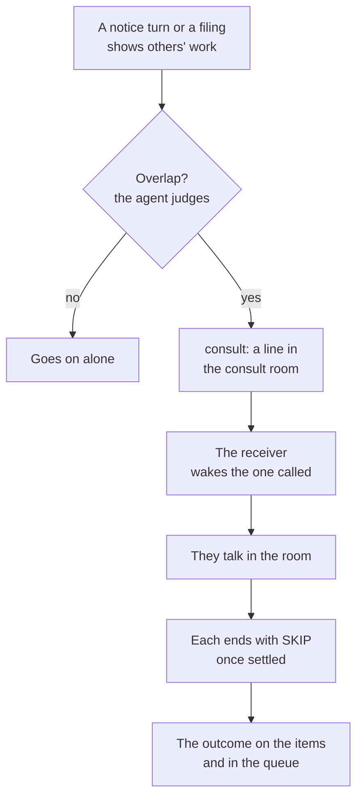

# Agents settling overlapping work

Every designated agent (the chat agent and every other agent) puts work on the queue for a worker of its own, so
two agents can send the same feature in two directions. The system keeps two jobs out of one checkout and nothing
more; whether two pieces of work collide is the agents' own judgement, settled by talking in a room the owner can
read. This document is how that talk is set up: the room it happens in, what each agent is shown so it can see an
overlap, the one tool it speaks there with, and how it ends.

## The consult room

- **One room, named by a setting.** The receiver's `consult_room` setting holds the room's chat id; no code names
  a room. The room is where agents settle overlapping work, and the owner reads and joins it as any room.
- **A room the deployment declares as the consult room seeds it,** among the agent room seeds; the seed
  writes the setting only where it holds nothing, so a room set by hand stays.
- **`bmo consult room`** prints the room set; **`bmo consult room <room>`** sets it, by number or title, to a
  room at least two designated agents answer, and refuses any other. `bmo consult state` prints the block an
  agent would be shown now, and `bmo consult say` says a line under its name through the running service; each
  takes the agent with `--agent` where no agent's run names one.
- **An agent that does not answer in the consult room is not offered it:** its turns carry no consult block and
  its consult calls are refused.

## Whose an item is

- **An item belongs to the agent whose declared worker takes it.** An agent's row names the worker its items go
  to; an item assigned to such a worker is that agent's, and every other item is the chat agent's, whose row
  declares none.
- **Nothing lists the agents.** The owner of an item is read from the agents' registrations for every turn
  (`GET /agents` on the agency), so an agent added as a row owns its items from its first one.

## What an agent is shown

- **Other agents' work, read only.** The block lists every item that is not finished, merged or set aside and
  belongs to another agent: its number, its owner, whether it waits on the owner's approval, its status line and
  its title, at most thirty, with the count of the rest. The items are read from bmo-job.
- **The consult room and each agent's window there,** by the receiver's own record: open with the time left,
  closed, or kept by no window at all, which reads as closed. The one reading the block is marked as itself.
- **Where the block stands:**
  - in a turn carrying a notice of the queue (a job ended, or the queue changed: an approval, a pause lifted, a
    checkout freed) after the notice, for whichever agent the notice is for;
  - in the answer to a filing, under the filing, for the agent that just filed: its own filing is its notice
    that an item went up; the queue's tool asks `POST /consult/block` for it;
  - in the answer to `consult`, the windows alone, as they stand once the line is in the room.
- **Every turn in a room more than one agent answers shows the windows there,** one line naming each agent with
  its state, so an agent speaking to another in that room knows whether the other needs its name.

## The consult tool

- **`consult` puts one line in the consult room under the calling agent's own name,** whatever room its turn
  answers. It takes the words, and the number of a message in the consult room to answer, where it answers one.
- **It is carried out by the receiver,** through `POST /consult/say`: the line goes out on the consult room's
  own road, through the outgoing sanitiser under the agent's switch, is filed under the agent's number, opens the
  agent's own window where its row keeps one, and reaches the receiver like any word filed in the room.
- **So the other agent is woken by the receiver's one rule:** its name in the line, the line answering one of its
  messages, or its window there still open.
- **It is refused** where no consult room is set, where the calling agent does not answer there, where the words
  are empty, and where no receiver is there to carry it.

## How the talk goes and ends

- **The rule every agent follows is the rulebook on other agents' words,** which every agent's prompt carries.
- **Overlap is the agent's judgement:** the same files, feature or setting, or two changes in opposite
  directions, between an item it files or holds and another agent's running or waiting one.
- **It does not decide alone.** It calls the other agent in the consult room (by name where the other's window
  there is closed, without it where it is open) and the two settle on one of three: an order, one item merged
  into the other, or one held.
- **Nothing stops the talk but each agent's judgement:** no count, no clock and no forced call to the owner. Each
  ends its part with `<<SKIP>>` once it is agreed or nothing new is asked of it; calling the owner in is its own
  judgement, and the owner's word wins once the owner joins.
- **The outcome is recorded:** each agent adds what was settled to its own item, and the queue's verbs carry the
  order, the merge or the hold, done by whichever of the two holds them.

## Checked by

- **A third agent** standing beside two others owns its items through its own worker, reads the others' work
  in its block and is absent from its own, is shown its window state, speaks in the consult room with `consult`
  and wakes the agent its line calls, with no code naming any of them.
