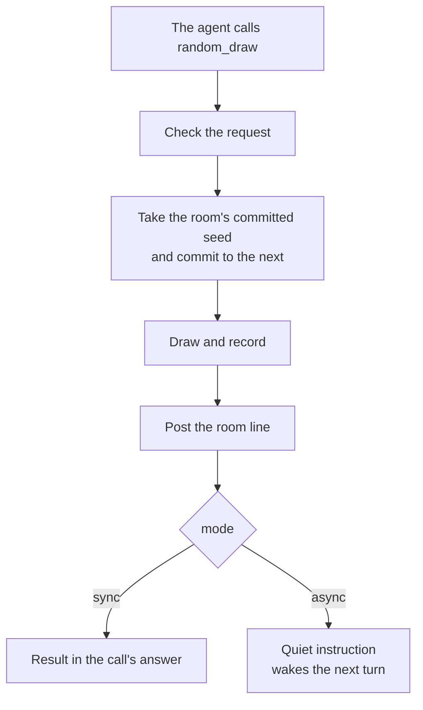

# Fair draws

## What it is for

- `random_draw` is an agent's one way to decide anything by chance: dice, a number in a range, winners picked out
  of a list, an order, a split into groups, a tie-break. Games are one use among many.
- A result an agent speaks of is always one this tool drew. An agent never states a roll or a pick it did not call
  the tool for, and never ends a turn having said it draws without a draw behind it; the chat manual holds it to
  that, and its procedure for fair draws says how to call the tool.
- Every draw is fair in a way anyone can check: its seed and its method are published with the result, and the
  seed was committed to before the request was known.
- It is an entry of the send tool (`docs/chat-mcp.md`), a sending entry that needs a room and a road that can
  carry text, carried by the receiver's `POST /sends`.

## The shapes

- **`dice`**: `count` dice of `sides` faces each, with an optional `modifier` added to their sum. Sides run from
  2 to 1000, count from 1 to 100, and the modifier stays within ±10,000. Only the sides are required: one die and
  no modifier are the defaults.
- **`range`**: one integer between `min` and `max`, both included. Both are safe integers, `min` is not above
  `max`, and the span holds at most 2^32 values.
- **`pick`**: `take` items out of `items`, none twice. The list is not empty, `take` runs from 1 to its length
  and is one when left out, and the list holds at most 1,000 items of at most 200 characters each.
- **`shuffle`**: the whole of `items` in a fair order, for an order of turns or a split into groups. The list
  holds from 2 to 1,000 items under the same limits.
- **`label`**, optional on every shape, says what the draw decides (an order of turns, a winner) and stands at
  the head of the room line and in the record.
- A shape given a field that belongs to another shape, or missing one of its own, is refused with a sentence
  naming the field, and nothing is drawn.

## The two modes

- **`mode` is required**, so every call chooses on purpose how the result comes back.
- **`sync`**: the call answers with the result, the seed, the method and the draw's number, and the same turn
  goes on with the result in hand. For a reply that states the result itself.
- **`async`**: the call answers at once with only the draw's number and the commitment, and the result reaches the
  agent as a quiet instruction that wakes it for the next turn, as a search's result does. For a turn that
  announces the draw and ends.
  - The instruction goes back on the road the call came in on. Queued while the calling turn is still going, it
    is held until that turn ends and opens the next one.
  - It carries the shape, the label, the result, the draw's number and the seed, and tells the agent to go on with
    whatever the draw was deciding in its own voice, without repeating the room line.
- **Both modes do the same draw.** The same seed, draw number and request give the same result in either; the
  mode decides only the way back.



## The room line

- **The tool posts it itself**, in both modes, at the moment of the call, on the turn's road. The agent does not
  post it again or read the seed out.
- **It is a fixed line**, plain text with no markup and no game flavour, so it reads the same under every chat
  service's dialect: its code and fields are rendered in the room's language by the web unit's language packs
  (`docs/voiced-notices.md`, 「Lines that stay fixed」), it is recorded as the agent's, and it is not rewritten by
  the outgoing sanitiser: a gate that folded a seed would make the draw impossible to check.
- **What it carries:**
  1. the label, where one was given;
  2. the result: the faces and their total with the modifier, the number, the picked items or the order;
  3. the draw's number and the seed;
  4. the method's name, `bmo-draw-v1`, with a clause saying what it is;
  5. the commitment this seed answers, or, on the room's first draw, a note that no commitment came before it;
  6. the commitment to the room's next seed.
- **A send that fails** is answered as a refusal after the draw is recorded, so the record never disagrees with
  what happened, and the draw is not repeated to get a line out.

## The seed chain

- **Every room has one pending seed**: 32 bytes from the system's cryptographic random source, kept secret, whose
  commitment was published with the room's last draw.
- **A draw consumes it.** In one write, the tool takes the pending seed, draws a fresh one for the room's next
  draw, records the draw, and moves the room on. Two draws in one room at the same moment therefore never share a
  seed.
- **The line publishes both**: the seed just used, which anyone can hash and compare with the commitment published
  before, and the commitment to the next.
- **So the seed was fixed before the request was known.** Nobody, the agent included, could choose it after seeing
  what was asked; the request only decides what is read out of it.
- **The room's first draw has no earlier commitment.** Its seed is made at that draw, and its line says so plainly.
  Every draw after it is covered by the chain.
- **What the chain does not claim:** the pending seed stands in the receiver's database, and whoever can read that
  database can read it before it is used. The chain proves the seed was not chosen after the request; it does not
  prove nobody saw it.

## The method, `bmo-draw-v1`

Written so anyone can reimplement it without this repository.

- **The seed** is written as 64 lowercase hexadecimal characters.
- **The commitment** is SHA-256 of that 64-character text, taken as UTF-8, written in lowercase hexadecimal. A
  shell checks one with `printf %s <seed> | sha256sum`.
- **The stream.** Block c, counting from 0, is SHA-256 of the UTF-8 text made of the seed's hexadecimal, a colon,
  the draw's number in decimal, a colon and c in decimal. Each block gives eight words, each four bytes read as an
  unsigned big-endian integer, used in order; when a block is used up the next is made.
- **A uniform integer below n.** Let the limit be the largest multiple of n not above 2^32. Take the next word; if
  it is below the limit, the answer is the word modulo n; otherwise take another. No value is ever likelier than
  another.
- **The shapes read the stream like this:**

  ```text
  dice:    for each die in order: face = 1 + uniform(sides)
           total = sum of faces + modifier
  range:   value = min + uniform(max - min + 1)
  shuffle: a = copy of items
           for i from length(a) - 1 down to 1:
             j = uniform(i + 1); swap a[i] and a[j]
           order = a
  pick:    shuffle items as above; picked = the first `take` of the order
  ```

- **Every shape reads the stream from its start**, so a draw's result depends on its seed, its number and its
  request, and nothing else.

## The test vector

Seed `000102030405060708090a0b0c0d0e0f101112131415161718191a1b1c1d1e1f`, draw number 1:

- The commitment is `6c86c6aac5fb24bcf5d9939cb7d7d5645ce39418f449e03b262dd4fa14b4b92b`.
- Block 0 is `f35dfdb8f3485c8047e663e36e0b4a13fd85b02df5dd85b40bf17e9f727301a9`.
- `dice`, 3 dice of 6 sides, modifier 2 → faces 3, 5, 4, total 14.
- `range`, 1 to 100 → 89.
- `pick`, 2 of a, b, c, d, e → c, b.
- `shuffle` of A, B, C, D, E → C, B, E, A, D.

The engine's own tests hold it to these values, so this vector and the code cannot drift apart.

## The verb

- **`bmo draw draw`**, a verb of the receiver's command line, draws as the tool does, by the same method and on the
  same rows: `--chat` for the room, `--mode`, `--spec` holding the tool's other fields (the shape, what it reads
  and the label) as one JSON object, and `--via` for the road. It is what an agent's shell reaches for when a call
  of the tool fails, and what a person or a job types.
- **`verify`** is its other form, below.

## Checking a draw

- `bmo draw verify <number>` reads the draw from the receiver's database without writing, draws it again, checks
  its seed against its own commitment and against the commitment the room's previous draw published, and prints
  `MATCH` or what differs.
- `bmo draw verify --seed <hex> --draw <number> --spec '<json>'` draws it again from the published values alone,
  with no database, for anyone holding a room line. `--commitment` names the commitment the line says the seed
  answers, and `--result` the result the line states; it prints `MATCH` when each one given agrees, and what
  differs otherwise.
- Either form exits with a failure unless it prints `MATCH`, so a check can be scripted.
- The quiet instruction an async draw wakes the agent with names the database form, so the agent can tell whoever
  asks how the draw is checked.
- By hand: hash the seed and compare it with the previous line's commitment, then run the method above.

## The record

- **Every draw is a row** in the receiver's `random_draws` table: the room, the road, the message it answered where
  known, the mode, the shape, the request, the label, the commitment it answered (none on a room's first draw), the
  seed, the result, the next commitment, the method's name and when it was drawn.
- **Each room's pending seed** is a row in `random_draw_rooms`, with the commitment to it.
- **The pending seed is never shown.** No read of the draws' store returns it, and no screen shows it. A seed is
  published only by the draw that consumes it, and from then on stands in that draw's row.
