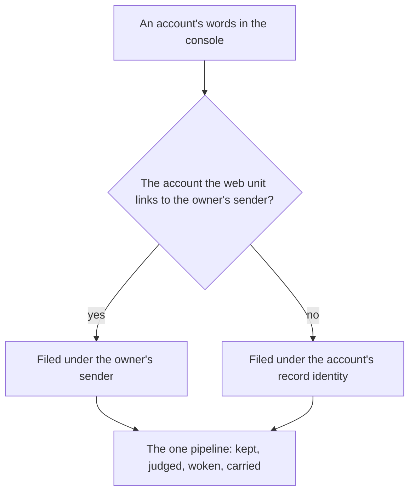
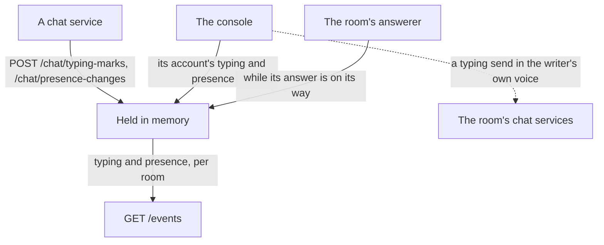

# The receiver

What the receiver is, what it carries, and how it stands among the units around it.

## Where it stands

```mermaid
flowchart TD
  CS[Chat services<br/>through bmo-chat] -->|POST /message, /attachment, /edited, /gathered| Rx[Receiver: rooms, wake, roads]
  Console[Console] -->|an account's words, members, the owner's road, reads| Rx
  Rx --> DB[(The receiver's database)]
  Rx --> Conv[The one runner:<br/>each agent's conversations]
  Pass[The instruction pass] --> Conv
  Job[bmo-job] -->|POST /instructions, /rooms/{roomId}/notices, /talks| Pass
  Conv -->|the envelope| Gate[the gate]
  Conv -->|POST /sessions/{sessionId}/turns| Agency[the agency]
  Agency -->|turn.ended and its other events| Conv
  Conv -->|answers, through bmo-chat-client| CS
  Rx -->|GET /events, GET /live| Screens[Console screens]
```

- **One receiver.** It stands where its configuration names its database, the owner and the default answerer; without
  the owner it stands no receiver and says so on its output.
- **What it carries:**
  - the secret-shaped runs taken out of a message's words before anything keeps or forwards them
    (`docs/messages.md`, 「Secrets taken out」);
  - the judgement of a message: whether the room is listened to; the owner's commands (allow, shut, pictures,
    mute, the two notices) with their acknowledgements queued as voiced notices; the
    message kept with the room's title; an agent's own words and a message already read stopped there; an edit
    written in place;
  - the wake: which designated agents of the room a message wakes, by the one rule (`docs/wake.md`), with
    everything that stops a message before it:
    - the owner's answer to a job's open question in the owner's private chat, handed to bmo-job;
    - the rest's gate, read off the agency's rest (`GET /rest`, and `GET /supervisors/{supervisorName}/road`
      for a turn the rest closes);
    - the read mark and a mute;
    - the window each agent keeps in the room, and the one a call opens for it;
    - the files a person posted just before the words of theirs that woke the default answerer;
  - the conversations (`docs/wake.md`, `docs/bmo-window.md`): each room's queue, rounds, window and waits, the
    round's turn on the agent's session with the room's words and the quiet instructions that arrive while it
    works pushed into it, the draft process its answer is made in and the room's words no push put in shown at its
    question boundaries
    (`docs/drafting.md`), the answer sent on the road the turn
    answers on with the room shown typing meanwhile, the fold, the failure orders and the cache warmer's touch;
    each answer sent is handed back to the receiver like any word filed in the room;
  - the instruction pass over every agent's rows (`docs/bmo-window.md`, 「The agent's queue」): each row handed to
    its room's conversation on the tick and at once where a row was queued, cold wakes paced, the rows that ride
    a round handed to it as it starts, and, as the receiver starts, every row a stopped round left handed and
    unsettled made pending again;
  - the restart (`docs/voiced-notices.md`, 「Deploy and restart」): a rest lifted past its end, every room but the
    owner's read up to its latest message and the owner told where it was a limit's rest; and, as the receiver
    starts, the owner's back notice with the deployment's unit, commit, subject, item and what it cut, then the
    words a restart left unread handed to every room that answers, one room at a time and in room order, the
    room's read mark advancing as its turn goes out; a room with nothing waiting is not served, and a line already served
    is not served again;
  - the console's talks about an item and a document (`POST /talks`), each turn a round of the owner's chat on the default
    answerer's session;
  - the one runner: each woken agent's turns in its conversations, every supervisor's alike,
    every agent's rows of the instruction pass, and the words the room sessions left untaken taken up as the
    receiver starts, each answer handed back to the receiver like any word filed in the room;
  - the console's road in (「Console rooms and accounts」 below): an account's words and files said in a room
    (`POST /rooms/{roomId}/words`, `POST /rooms/{roomId}/word-files`), a room's members by account, and the
    record identity of each account; and the owner's road, `POST /owner/messages` and `POST /owner/message-files`
    into any room it holds, the second with `voice` for a recording;
  - the delivery of every kept message to the room's chat providers (「A room's chat providers」 below);
  - the words' form of its own sends: the scaffolding guard, the dash net, and the words handed to the room's chat
    service in the form its dialect reads; refused where nothing but scaffolding is left;
  - the going-down line said to the owner as it stops (`docs/voiced-notices.md`, 「System notices」);
  - the event stream and the live board (「The event stream」 below).
- **What it does not carry:** a chat service's platform (its reading, its sending, its gathering of files and its
  numbering are the chat service's, behind bmo-chat), the agent sessions and the road each supervisor stands on
  (the agency's), the gate stage (the gate's), the memories and digests (the brain's), reminders, waits and watches (the wait tool's,
  run through bmo-cli's `bmo use`, `docs/reminders.md`), the job queue (bmo-job's), the accounts and grants (the web unit's), the voice (the voice
  unit's), and the keepalive pass (the cache warmer's).
- **A woken agent's turn is its conversations' own:** the message goes into its room's queue with the files
  leading up to it ahead of it, opening the window where its ground does. A turn the rest's gate closed is taken
  only where the agent is pinned to a provider the rest does not close, or the agency answers that the
  supervisor's one road takes a turn now. A
  message read through somebody else's account, or by a read mode its chat service declares answers cannot be
  pinned to, goes in as read through a reader, so no answer is aimed at it. The owner's words from the screen go
  into the owner's conversation the same way, opening nothing.
- **Another unit reaches the conversations through the instruction pass alone:** a row it queues is delivered as
  any is.
- **A row queued for an agent that no longer answers its room goes to the room's voice:** a run's ending whose
  asker was taken off the room or rests, or a job's instruction for an agent gone from the room, is queued for the
  agent that speaks for the room (`docs/boundary-api.md`, 「For bmo-job」), so the result is told in the room's
  own voice. A row whose agent stops answering after it was queued is let go by the pass, as every row no turn
  could take.

## The one hard rule

- **A chat service's key may be stored, logged, shown and looked up. It may never be compared to a literal.**
- Allowed: kept on a message row, written to the log, shown on a console screen, handed to bmo-chat-client to reach
  that service.
- Forbidden: a comparison against any service's key anywhere in the receiver, and equally a chat-number range test
  or a message id sign test standing in for one.
- **Every difference is asked of the declaration instead** (`GET /declaration` and the room routes): the
  capabilities, the read modes, the dialect, the numbering, who the agent is in this room, whether this room is
  the owner's private chat, whose one-to-one with the agent it is, whether the service lists its account's rooms
  and whether it answers in the account of the person it reads.
- **A screen follows the same rule:** what the receiver answers a screen about a provider is read off its
  declaration, so a screen offers each provider what it declares and branches on no provider's name either.
- The reason is the cost of the next chat service. A comparison to a literal is a branch somebody has to find and
  extend; a question asked of the declaration answers itself for a service that did not exist when the question
  was written.

## A room's chat providers

- **A chat service that refuses the connection is skipped at once for the turn.** Its client offers the request
  once, the receiver logs the failure once, and the turn goes on to the room's other roads; a service that is
  live but slow is still waited on. A road that is down is not waited on until it listens, as other units' calls
  are.

- **A room is on one or more chat providers, and which is one setting of the room's registration.** A provider is
  a road a room's messages come and go on, and the setting says both ways which: whether a messenger's messages
  for the room are taken, and whether what is said in the room goes out to that messenger. Every room stands in
  the web console whatever its providers, since the console reads the archive. each chat service the configuration lists, and the room's record, the
  road the receiver keeps itself, which is the web console's, since the console reads the archive. Each is named
  by its key, as the record's stands in the policy and a chat service's in the configuration; nothing here names
  one provider apart from the others.
- **The list is read and set over `GET` and `PUT /rooms/{roomId}/providers`** (`docs/api.md`, 「Rooms」). A room
  whose list was never set is on every provider that has handed it a message or kept one in it, in the order
  each first did, and on the chat service that says the room is its own, so a room stands where it stood until
  its list is set.
- **Every message kept in a room goes to each of the room's providers,** whoever said it and whichever road it
  came in on: a person's words a chat service handed over, the owner's words from the console, an agent's
  answer, a line the receiver says itself. The rule is the same in every room and turns on nothing but the list.
  - A provider the message already stands on is not handed it again: the road it came in on, and the road a
    line of the receiver's went out on, under whose number the record keeps it. The record holds every kept
    message by being the archive, so it is never sent anything.
  - Every other provider on the list is handed the message through its own `POST /sends`, as the words or the
    files the message carried, the caption with the first file, answering the message it answers where that
    message stands on that provider under a number of the provider's own.
  - A message the owner said goes in the owner's own voice, `human-reader`, as the chat protocol names a send in
    the owner's own words; words another account said in the console go as 「An account's words on a messenger」
    below says; any other goes in the voice the provider answers the room by.
  - The voice a provider answers a room by is the one every send the receiver makes there goes in where the
    send names none of its own, an agent's answer, a line, a typing indicator or a message carried, and the
    one an act refused in the voice named is tried again in: `human-avatar` in a room added `avatar`
    (「Adding a room」); in a room never added, `human-avatar` where the service's declaration holds exactly
    one mode active and that mode is `human-avatar`, the one voice the service stands on; and none otherwise,
    the send naming no voice and the service answering in its own. A room in `record-only`, and a room on a
    service that declares several modes active or none, keep naming none. A voice the send names, the
    owner's own among them, stands above it. The owner's own voice, `human-reader`, is never the voice a room
    is answered by, even where it is the one mode a service has active: it goes on the owner's words alone, and
    a send in it is the one a read-only room takes (「A read-only room」).
  - Every send the receiver makes to a chat service names the account it goes out in, as `accountId` (bmo-chat's
    `docs/contract.md`, 「The account a call is for」), from the room's leaders, the accounts that own a supervisor
    the room names (`docs/api.md`, 「Rooms」): the account of the supervisor the send speaks as where that
    supervisor is one of them, else the one leader of a room that has exactly one; a room with no leader, or
    with several and a send that speaks as none of theirs, names no account, and the service sends in its own.
    The leaders are read as the agency's list of agents is kept (「What is kept for a moment」); where that list
    cannot be read, the send names no account.
  - Each send carries a `tag`, and the number the provider gave it is kept beside the message. A message a
    provider hands over that is the echo of such a send, by its tag or by that number, is the message already
    kept: it is answered as held, kept no second time and wakes nobody.
  - A message a provider hands over that answers its copy of a message kept under another number, by the number
    the provider gave the copy, answers the kept message: it is kept naming the number the room keeps that message
    under, and is read, woken on and carried on as a reply to it.
  - A provider that refuses or does not answer is said in the journal and leaves the message kept as it is.
- **A chosen list rules both directions.** A message a chat service hands over for a room whose chosen list does
  not name that service is not taken: it is not kept, wakes nobody and is not answered, and the journal says so
  once for the room and the service. Nothing of the room goes out on a chat service the list does not name: no
  answer, no send, no line the receiver says itself, no notice and no picture.
- **A chosen list names the room's own road: its first provider.** A turn whose words came in on a road the list
  names answers on that road; every other answer, every send that names no road or one the list does not name,
  and every line nobody asked for goes on the room's own road. Where a room has chosen its list, neither whether a
  road shows the room's whole line nor whether a chat service reaches the room beyond its own rooms is read for
  it: the list alone decides.
- **A room on the record alone** reaches no messenger: what is said there stands in the archive and the console,
  whether or not a chat service holds the room. A room whose list names the record alone is such a room; so is a
  room no chat service holds and whose list was never chosen, where the receiver numbered it on the record or
  keeps messages of it: an agent's console room is born with the record as its one provider.
- **No chat service is asked of a room the record holds alone by its own rows:** one whose chosen list names no
  chat service the configuration lists, or one whose list was never chosen and whose number the record gave. What
  such a room is comes from its record, whether every chat service is up or down: it is the owner's private chat
  only where it is the owner's private room the configuration names, it is a one-to-one only where it is a BMO's
  private room, with its owner account's record identity (「Console rooms and accounts」 below), the agent's words there
  stand under no number of a road's, no road reads it in the owner's account, and its own road is the record. Its
  words are kept and wake its answerers by the one rule every room's words are judged by (`docs/wake.md`). Every
  other room's facts are asked of the chat services that may hold it.
- **Detaching a messenger is taking it off the list,** and attaching it again is putting it back, from the
  console's provider setting: from then on its messages for the room are taken again and every message kept is
  carried to it. Nothing else of the room changes, its record and its registration among them.

## A read-only room

- **A chat service reads a room in the owner's account alone** where its answer for the room states the room's
  `modes` and they hold `human-reader` alone. Where its answer states no modes, the room is read so where the
  service reads through the owner's account (it declares the `human-reader` mode) and either that is the one
  voice it has active, or its answer holds the room under no identity of its own: no words of its own account
  stand there, only the owner's. The service's declaration and its answer for the room are read as they are kept
  (「What is kept for a moment」), so a room whose service starts answering there, the account the road sends
  through joining it, stops being read so at the next read of its facts.
- **A room is read-only where its list of providers names at least one chat service and every chat service on it
  reads the room in the owner's account alone.** The room's record on the list changes nothing either way: a room
  on the record alone is answered in the console as any room is.
- **A read-only room is listed, read and kept like any other,** and its messages stand in the archive, where the
  agents read them as archived messages from their turns elsewhere.
- **The people's words in a room of the owner's account are read only where the room was added.** A chat
  service reading a room through the owner's account asks the receiver for the room (`docs/api.md`, 「The chat
  services」), and the answer's `read` is true for a room added on that service (「Adding a room」) that is still
  on its list of providers, whatever its mode; for every other room it is false. So a room of the owner's account
  that was never added hands over the owner's own words alone, and one added hands over everyone's: a room added
  `avatar`, which is not read-only once its service answers there as the person, is read as a room added
  `record-only` is, so the words its agents answer reach it. A service that reads a room through an account of its
  own reads it whether asked or not, and a `read` there asks it nothing more.
- **The agents never answer in it:** no message wakes an agent there, whether it calls one by name, replies to
  one's words, falls in an open window or carries a picture (`docs/wake.md`, 「Who reaches the session」); a quiet
  instruction queued for it is let go undelivered; a send an agent asks into it is refused `read-only-room`
  before anything is sent or kept; and a line the receiver says itself is not said there.
- **The owner's own words still go out:** words the owner typed into the room from the console are kept and
  carried to its chat services in the owner's own voice, `human-reader` (「A room's chat providers」), as in any
  room.
- **A chat service that reads a room in the owner's account alone is handed the owner's words alone,** in any room
  whose list carries it: every other message kept there is not carried to it, and nothing else is sent to it in
  that room.

## An archived room

- **A room is archived and locked by the administrator, by its leader or by a head of its unit:** its leader is the
  person who owns a supervisor the room names, and the room belongs to the leader's unit, so a head of that unit or
  of one above it locks it too (the web unit's `POST /checks/unit`). Archiving keeps the room's record, title, providers and messages as they stand; it is undone by the
  same people, and the room then stands as it did.
- **An archived room is listed and read like any other,** its messages standing in the archive for the people and
  agents who could read them before.
- **Nothing more is said in it:** no message wakes an agent there, a quiet instruction queued for it is let go
  undelivered, a line the receiver says itself is not said there, words or files typed into it from the console are refused 409 `room-archived` before anything is
  kept, and a send an agent asks into it is refused `archived-room` before anything is sent or kept.

## Adding a room

- **A room is added by choosing a chat service, one of the rooms its account is in or a conversation started
  with its contacts, and a mode,** and the receiver owns the room and its mode from then on (`docs/api.md`,
  「Rooms」). Each choice is offered by what the service declares, asked afresh each time since a mode's standing
  moves while the service runs:
  - the rooms offered are the list of a service that declares `roomList`, relayed page by page as it answers it,
    each marked `held` where the receiver already holds it: its own, one it keeps a title or a message of, or one
    added. Whether a room is held is the receiver's own record, never the service's (bmo-chat's
    `docs/contract.md`, 「The rooms of the account」);
  - the contacts offered are the list of a service that declares `contactList`, relayed the same way, each with
    the one-to-one the service's account already has with it, marked held as a room is. A one-to-one is started
    with one contact where the service declares `startChat`, and a group with several under a title where it
    declares `startGroup`; the service starts it, and the room it comes to is added as a room chosen from the
    list is. What the started room is, read-only or answered, is the service's answer for it;
  - `record-only` is offered on every chat service, and `avatar` only where the service's `human-avatar` mode
    stands active. A platform whose terms forbid automating a person's account declares that mode `unsupported`,
    so it is never offered there. A room whose answer states `modes` without `human-avatar` takes no `avatar`
    either: a read-only room is never answered in.
- **Adding keeps the room on the service and the record:** the room's mode, its title and its list of providers
  set to the service it was chosen on and the room's record (「A room's chat providers」 above), so whatever mode
  it is in, every message said in it stands in the archive. A room the service does not say is its own, a mode
  the service does not offer or the room does not take, and a room already added are refused, and nothing is
  written. A mode the service does not offer is refused before a conversation is started, so nothing is made on
  the platform for an addition that cannot stand.
- **The mode is what the room is to the agents:**
  - `record-only` is the user alone: the room's messages are kept and carried as any room's, and no agent is
    woken by them (`docs/wake.md`, 「Who reaches the session」);
  - `avatar` is a room answered as the user: the room's designated agents are woken by the one rule, and every
    send the receiver makes there that names no voice of its own, an answer, a line or a typing indicator, goes
    in the `human-avatar` voice, the account of the person the service reads.
- **A group room names its leader's BMO where it names one,** one of the supervisors of the person who made the
  room and no other member's; a group naming none carries none, and the default answerer answers it
  (`docs/wake.md`, 「Who reaches the session」). A member's own supervisor reads the room's messages without
  answering it (`docs/api.md`, 「Messages」).
- **A supervisor adds a chat-service room only on the owner's word and only in `record-only` mode,** through the
  `rooms` tool's `room_add` entry or `bmo room add` (`docs/chat-mcp.md`, 「The rooms tool」): it answers on the
  turn the receiver marked the owner's, and refuses a turn that is not, since no grant in force names adding a
  room. A call naming no room, a contact or the contacts of a group answers the provider's rooms and contacts by
  name, each with whether the receiver holds it, so the owner picks; the addition is the receiver's own
  `POST /rooms` (`docs/api.md`, 「Rooms」) and its refusals are the receiver's own. Avatar mode and an existing
  room's mode are not this road's: the console's registration screen alone changes a mode.
- **A room never added has no mode** and stands as the roads that handed it messages make it. A send there that
  names no voice of its own goes in `human-avatar` where that is the one mode its service declares active
  (「A room's chat providers」).

## Reading and changing a room's mode

- **The administrator reads a room's registration** through `GET /rooms/{roomId}/registration`, `by` naming him
  as the web unit knows him: its mode, its list of providers and whether that list was chosen, the agents
  answering it, and whether it is read-only. It is read-only where every chat service on its list reads it in the
  owner's account alone (「A read-only room」 above), and `readOnlyBy` names those services.
- **The administrator changes the mode between `record-only` and `avatar`** through
  `PUT /rooms/{roomId}/registration`, and the room's record, its title, its list of providers and its messages
  stay as they stand. A room never added has no mode and is refused `room-not-added`.
- **`avatar` is refused where it cannot be answered in.** Every chat service on the room's list must declare its
  `human-avatar` mode active, else `avatar-unoffered`; its answer for the room, where it states modes, must hold
  `human-avatar`, else `room-takes-no-avatar`; and a room on no chat service is refused `no-chat-service`, since
  no account there stands to answer as the person. Nothing is written by a refused change.
- **A mode does not make a read-only room answer.** A room its chat service reads in the owner's account alone
  stays read-only in every mode: `record-only` only says no agent is woken, which the read-only room already
  holds, and `avatar` is refused. What would make it answer is the service's own account standing in the room,
  which the room's platform gives and this route does not; the route changes a mode and nothing else.

## The owner's words

- **`POST /owner/messages` and `POST /owner/message-files` put the owner's words into a room from the console.**
  - The words, and the caption a file or a voice note carries, are read for secret-shaped runs before anything
    is kept (`docs/messages.md`, 「Secrets taken out」); words that are nothing but markers are kept and wake no
    agent.
  - The words are archived in the room under a console number (`docs/unified-bmo.md`, 「The cases」), under the
    owner's number and the owner's own name, and handed to the room's conversations as any of the owner's words
    are; then they go to the room's other providers as every kept message does, in the owner's own voice.
  - A `replyTo` names the archived message the words answer; one the archive does not hold is refused 409 and
    nothing is kept.
  - Files are archived each as its own message with the words typed beside them; they go to each provider as
    one album of the pictures and videos, one of the sounds and each document on its own, the words on the first
    send that takes a caption that long and ahead of the files as words otherwise. A file
    past the ceiling a road takes is refused 413 and turned away with its name, and a call none of whose files
    stood answers as one refusal.
  - A voice note is the same form with `voice`: one sound file, kept as a message under the voice word and the
    caption beside it, and handed to the room's other providers as a voice message with that caption. The
    console records it; no reading of it is made, so what it says stands only in the recording. A call with
    no file, more than one, or one that is no sound is refused 400, and a file past the ceiling 413.
- **`POST /owner/instructions` says the owner's words to a room's session**, marked as the owner speaking from the
  console and carrying his text as data, read for secret-shaped runs first (`docs/messages.md`, 「Secrets taken
  out」) and delivered as a quiet instruction, with the rule the marker stands for in the room's block, so the
  room sees nothing but the answer it leads to; a chat the archive has never seen is refused.

## Console rooms and accounts

The console comes first and a provider only supplies chat and connects it; in the console a person is their
account (`STRUCTURE.md`, 「Accounts, companies and units」). The console server acts for the accounts and calls the
receiver under its token; the receiver judges no right of an account, which the console asks the web unit before
it calls, but it holds the rules below whoever calls.



- **The console's road is not the owner's road.** What is granted to the owner hangs on his sender, which the web
  unit links to his account, and never on words having come through the console: his commands, a grant made on
  his message, his wake in his private chat, the owner's directive a round owes an answer to, the turn marked his
  that files work as asked by the owner, his answer to a job's open question, `sender-is-owner` and `owner-spoke`,
  and his own voice on a messenger. `POST /owner/messages`, `POST /owner/message-files` and
  `POST /owner/instructions` are the owner's road; the console uses them for the owner's account alone.
- **An account's record identity** is the number its words stand under on the record, the console's road: a row
  of the record's numbered people keyed by the account, made the first time it is asked for
  (`PUT /accounts/{account}/identity`) and the same one ever after. The web unit links it to the account's user
  as it links any chat service's identity, so every reading that asks whose user a sender is reads it as that
  account's: a member's own supervisor reading the room, and the call of one's own supervisor where the room grants
  `ask` (`docs/wake.md`, 「Who reaches the session」).
- **An account's words** (`POST /rooms/{roomId}/words`, `POST /rooms/{roomId}/word-files`) are filed under the
  owner's sender where the account is the one the web unit links to the owner's sender, and under the account's
  record identity otherwise, made where it is missing; under the owner's name in the room for the owner, as his
  words from the console always stood, and under the shown name the console gives for any other account. From
  there they are kept, judged, woken on and carried exactly as any message, whether the sender is the owner read
  off the sender as for every message. A web unit that cannot say which account the owner's is refuses the words
  502 `upstream-failed` and nothing is kept.
- **A room's members are accounts.** In a room on the record alone they are the accounts let into it; in a room a
  chat service carries they are those beside the people the service lists, whom the console links to accounts
  itself. An account is let in by another (`by`), and goes out by itself or is taken out; each of those writes a
  line into the room saying who did what to whom, a fixed line the room's members all read (`docs/voiced-notices.md`,
  「Lines that stay fixed」). A member taken out is no longer listed and no longer reads the room through its
  membership. An agent room opened by an account (`POST /rooms`, `openedBy`) has that account as its first member,
  let in by itself and with no line.
- **A BMO's private room is the record room written when the supervisor was added,** naming it alone: its own
  room under the supervisor's name on the record. It is one-to-one with the supervisor's owner account, the
  account its addition names as `ownerAccount` or, where that named none, the one the agency's registration names;
  the owner's private room is one-to-one with the owner's account, the one the web unit links to his sender. That account is its one member and the room's one-to-one person is its record identity
  once that stands, so its words wake the supervisor with no name and no open window, as a user's own private chat's do
  (`docs/wake.md`, 「Who reaches the session」), and the room is no group: no member's supervisor reads it.
- **Whose private room a room is is a fact kept on its record** (`private_rooms`, `docs/store.md`), and no read
  asks another unit for it but the owner's link. The record keeps one row a room: no row is no private room, a row
  naming an account is that account's private room, and a row naming none is a private room whose account is not
  known, sealed. A row naming none is filled in once its account is known; a row naming an account never changes
  or clears by itself, so a retired BMO's room, a supervisor no longer listed and an account that has left all stay
  that account's private room. No read assigns a room to an account on what the agency lists now. A room is
  assigned by these alone:
  - **a BMO's own room by the addition that makes it,** `POST /supervisors` naming its `ownerAccount` onto a room
    this addition writes. An addition under a name whose room stands already takes it back only where the record
    keeps it as the private room of the account the addition names; any other standing room, one the record keeps
    nothing of among them, is sealed and the name refused `name-taken`, so a supervisor added under a retired
    one's name never reads what was said there. The room's half is written before the agency is asked and taken
    back where the agency does not stand the supervisor, so a refusal leaves nothing in either;
  - **every BMO's own room once, by the first start that reads the agency after the record began keeping private
    rooms:** each own room the record keeps nothing of is assigned to the owner its supervisor's registration
    names, and the pass is marked done in the record. Registrations made before the receiver handed the agency the
    addition's owner account name none, so a supervisor whose registration names none and whose name is exactly
    `u<n>`, `n` a positive number written without a leading zero, the name the console gives the BMO it stands for
    account `n`, is read as account `n`'s; the name gives the room only to the account it names, never to whoever
    registered it, and any other ownerless supervisor's room is left no one's. Every start after only seals the own rooms no registered
    supervisor claims and assigns none; a BMO's own room is one standing on the record under a supervisor's name
    whose number on the record stands;
  - **the owner's private room by the web unit's link of his sender alone,** asked only while the record keeps no
    account of it, and kept once the web unit names one. The owner's private room is the one the configuration
    names and the one a chat service says is his private chat with the agent.
- **Which rooms are private is the receiver's to say,** from these rules alone: every room read answers
  `privateOf`, the account whose private room it is, or null, and `sealed`, whether it is a private room whose
  account is not known yet (`docs/api.md`, 「Rooms」). A room is never private by how many members it holds or
  which providers it is on: a group room every other member has left stays a group room, `privateOf` null, and its
  writes are judged as any group room's.
- **Who reads a private room:** its account, and the administrator, who reads every room (`STRUCTURE.md`, 「The
  superadmin reaches everything and changes nothing of another's」). This is the one place the receiver states
  it. The administrator's read changes nothing of another's: no read route of the receiver keeps anything of who
  read, so his read leaves no mark, no window opened, no wake and no event; and in a private room that is not his
  own, every write he makes is refused like any other account's.
- **Nothing in a private room is said or changed by another account.** Every route that changes a room, a message
  in it or what is kept of it reaches the room through one guard, which reads who the write acts for off the
  request and refuses another account's private room before the route holds anything; a route has no other way to
  its room. Who acts is the account the call names, as `account` or `by` in its query or body or as the relay's
  `Owner-Key`, one account wherever it is named and refused 400 `bad-request` where two differ. In a private room a
  write for any account but its own, the administrator's among them, is refused 403 `private-room`: words and
  files, every act on a message, a sticker, a forward out of the room or into it (a forward shares what was said in
  the one and writes in the other), a line's reading aloud (a turn of the line's agent in the room and a briefing
  the voice engine keeps for it), the room pinned or unpinned in the console's pinned order, the room's picture,
  its providers, its mode, its archive, the supervisors it names, a unit's notice into it, an agent's read marks in
  it, its files filled, and its removal. A member let in or taken out of a private room is refused for every
  account, its own among them.
- **A sealed private room is written in by no account.** A room kept as no one's whose privacy cannot be asked,
  the agency not answering, refuses every account's write 502 `upstream-failed`; the owner's private room is
  private whatever the web unit answers, so it is read as sealed while its account cannot be asked. A BMO's own
  room whose person cannot be read has its facts read as sealed, so it is no group: no member's supervisor reads it
  and nothing of it is carried into another chat.
- **When a private room's account is removed, the room stays on the record, sealed to everyone else:** retiring a
  BMO leaves its room standing and kept as its account's, and an account that leaves keeps its private rooms as
  they stand. The account reads its room while it exists, the administrator reads it and writes nothing there, and
  no other account writes in it; nothing removes a private room but its removal by its own account.
- **The owner's own road writes as the owner:** `POST /owner/messages`, `POST /owner/message-files` and
  `POST /owner/instructions` write in his own private room always, whether or not an account is linked to his
  sender yet, and in a room no account's private room always; a room the record keeps nothing of is no one's, and
  the web unit is not asked of it. In a room private to an account they write where the call names that account,
  or, naming none, where the web unit links that account to the owner's sender, asked only then; in a sealed room
  other than his own they never write. So while no account is linked to his sender the owner speaks as before in
  his own private room and in every group room, from the console's owner road and from a chat service alike, and
  writes in no account's private room, his own BMO's among them, until the link names his account. A chat
  service's hand-over of his words is a unit's and judged nowhere.
- **A unit acting as itself names no account,** under the receiver's token, and is refused in no room: an agent's
  own acts through its tools (`POST /sends`, a handoff, a handover, a talk), a unit's instruction or notice into a
  room (bmo-job and the agency: `POST /instructions`, `POST /rooms/{roomId}/notices`), the brain's read marks of an
  agent's book, a chat service's hand-over, the receiver's own lines, and the `bmo` command line acting as the
  deployment. The console never writes for a person without naming the account it acts for.
- **A forward is the forwarding account's:** the copy stands under the sender that account speaks as, the owner's
  for the owner's account and its record identity for any other, and is carried as that account's words are; a
  forward naming no account is the owner's.
- **An account's words on a messenger.** The room's chat services are handed the words as every kept message is
  (「A room's chat providers」), each provider deciding by what it declares how the speaker reaches its room:
  - the owner's words go in his own voice, `human-reader`, the account his reader on that service is;
  - another account's words go in the provider's own voice, a `bot-account` or `own-account` mode it declares
    active, and name that account as the one they go out in (`accountId`), never the room's leader's, so a
    provider that holds an account for each person sends them in that person's own or refuses them. A provider
    that declares `speakers` is handed the account as the speaker, `account:<account>`, and speaks as the identity
    it links to that account where it holds one; where it refuses that speaker, or declares no `speakers`, the
    words go in its own voice with the speaker's shown name before them, as the policy's `[relay]` form writes it
    (`roads.toml`);
  - a provider with no voice of its own active is handed nothing of another account's words, and the journal says
    so, so no account's words go out in another person's account.

## The event stream

- **The frames of `GET /events`:**
  - `event: run` first, naming the stream's run, the moment the receiver's process started;
  - each event as `id: <n>`, `event: bot` and its JSON, out of a ring of the last 500, replayed after the cursor.
    The ring is there so a screen whose stream dropped picks up where it was, so a cursor is read only against
    the run it was taken in: one from another run is handed the whole ring, and a reader naming no run has
    nothing to pick up and starts at the present, with no replay;
  - `event: live` with the picture as it stands, after the replay and with no id;
  - the present picture of each turn that works (`run-progress`), which stands until the turn ends or a newer
    one takes its place: a reader starting at the present is handed every one after the picture, which names
    their turns; a reader with a cursor is handed, ahead of the replay, those after its cursor that the ring no
    longer holds, so the ids it is handed still rise;
  - the typing marks that stand and the presence known in the rooms (「Typing and presence」 below), after the
    replay, the picture and the turns that work, each as `event: bot` with no id, so a screen opened late shows
    who is writing now and who is reachable;
  - `: ping` every fifteen seconds;
  - `event: stopping` with no id when the receiver stops on purpose, after which the stream ends. The signal
    tells every stream at once and the serve lets go only after them, so a stop never waits out a stream that
    was not told.
- **What goes into it** is the news the receiver makes itself: a message it kept or wrote again, a window opened
  or restarted, a window closed as `window-closed` with its room, its agent and `closedAt`, the moment it closed
  (`docs/wake.md`, 「The names and the window」), a verdict it wrote of a round as `judgement` with its
  `messageId` (null where it stands under no message yet), `stage`, `verdict` and `detail`, each row of a round's
  draft process as `draft` with its `round`, `agentName`, `number`, `question`, `kind`, `answerChars`, `changed`,
  `outcome`, `detail`, `ms`, `at`, `reads`, `session`, `loaded` and `versions`, on the end what the round read
  from the brain, the session its turn ran on and what that session had read in full in the room before it, and on
  a turn's row the program's turns it spanned, each empty or null where it does not stand (`docs/drafting.md`, 「The
  round log」), each question of it as it starts as
  `draft` of kind `start` with its `round`, `agentName`, `number`, `count`, `question` and `at` and none of a
  row's answer fields, a turn of a conversation as
  it begins, moves, sends and ends, each of these under the turn's `speaker` (`docs/api.md`, 「Events and the live
  board」), a room whose
  registration was removed as `room-removed` with its
  number, the picture whenever it
  changes, a typing mark and a presence as `typing` and `presence` (「Typing and presence」 below), and what
  `POST /events` says (a message or a briefing checked against the archive first, the profile pictures a chat
  service took).
- **A typing mark and a presence are told and never replayed.** They go to every listener as they come, with no
  id and outside the ring, so a burst of them never pushes a room's messages out of what a screen picks up again,
  and a mark that ended is never handed again as news; what stands of them is handed on opening instead.
- **The picture (`GET /live`) is drawn of what the receiver runs itself:** the chat turns of every agent's conversations,
  the rooms whose session it is folding and the message each room queued for a turn, the picture going
  out again as each of them begins, moves or ends. A turn names the messages it read and, as `messageId`, the one it
  reads last; words it takes while it works — pushed into it, or shown under a question of its round — move it on,
  so from then it names the newest of them as the one it reads last, among the rest it read. A queued message is
  let go once a turn of its room has read it — every message the turn read, those it took while it worked among
  them, not only the last — or when another is put in after it. With none of them standing, it is empty.
- **A turn's progress is read off the lines its run leaves in the agency's log as they come** (the agency's
  `docs/run-records.md`, 「Agent log」): the stream lines of an agent's own road, and the `progress` and `answer`
  lines a pane program's record writes. A record naming no phase, no tool or no usage leaves what the picture
  already holds: the phase, the tool being called, the thinking and the tokens each request spent, the written
  estimate, and how full the session stands. A pane program's `progress` line carries the turn's spend so far,
  and its `answer` line carries the turn's whole spend: what the requests spent and how full the session
  stands are set where they stand, never added to.
  - **The thinking and the written figures are the turn's running totals, and move only forward while it
    runs.** Thinking and written follow one rule. What one block or one request states for itself is added
    to what stands: a block's estimate, a stretch of thinking the program counted, a request's thinking
    tokens. A request's measured output is counted once by the request's id, at the largest figure its
    lines or events report, so a request that states a partial count first and its whole later counts the
    whole once. A figure the program states for the whole turn so far, the running count of its thinking or
    a pane program's output, is not added: the figure stands at the greater of it and what was already
    counted. Measured output, a request's or the turn's, covers the thinking, the words and the calls
    together, so the thinking and the written figures together reach at least what was measured, the
    written figure making up what the thinking counted does not; an estimate counted beside a measured
    figure, as the call lines a pane program's run files beside its `progress` lines, stays where it stands
    above it. The `answer` line's measured output replaces the written figure once the turn ends, so the
    turn ends on the program's own count.
  - **A line the agency filed already told apart is read as what it names.** A road whose program keeps its own
    record is filed as lines of a kind — a thinking block, words, a call, a call's result — each holding its words,
    and beside them, in its metadata, the request its message answers: that request's id and the usage the
    provider stated for it (the agency's `docs/api.md`, 「log-lines」). A thinking line puts the turn at thinking and words at writing; a call puts it at the tool the
    line names and stands in the picture's actions, the words held before it becoming progress lines; a result
    settles the call it answers. What the turn thought and wrote is counted by estimate, from those lines'
    length, and reaches at least what the requests the lines name measured as their output. How full the
    session stands is the latest request's input, read and written cache together, and what
    the turn spent adds each request once, by its id, as a record's own line would; a line that names no request
    leaves both as they stand.

  - **The block a turn is still writing is read from the agency beside the lines** (the agency's `docs/api.md`,
    「sessions」): a line says a block only once it has ended, so on every look the session's open block, as the
    model gateway counts it, is read after the log, and the bytes it has written so far stand in the picture by
    estimate on top of what the lines have said — under thinking for a thinking block, under the written figure
    for words and calls. A block that ends is let go of, and its line says it from then on; a look that finds none
    open, or a read that fails, leaves no open block in the picture. The figures a look draws are the least any
    later look of the turn draws: the gateway lets go of a block before its line is filed, and a call's line
    holds a summary of its arguments rather than the bytes it streamed, so the figures hold where they reached
    until the lines pass them. The `answer` line of a pane program's turn lets go of them with the rest.

  The log is read as each of the turn's events comes and once every look the pushing policy sets
  (`chat-round.toml`, `[pushing]`), so what the run writes reaches the picture within that look.
- **A turn's picture goes out only where it changed.** One whose drawn part changed (its phase, its tool, its
  actions and how many were dropped, its progress lines and its thinking) goes out at once; one whose counts
  alone moved (the tokens, the request and its spend) goes out at most once the progress gap
  (`chat-round.toml`, `[progress]`) after the last that went out; one the screens were told already is never told
  again, however long the turn works or waits. A screen that connects later is handed the turn's present picture
  on connect, as the stream's frames above say. A look whose read fails leaves the picture as it stands until the next; a read an
  event called for that fails ends the turn as a fault.
- **A turn's progress lines are the words it writes and then goes on working,** shown in the room while the turn
  works and no part of its message. A text block the turn writes is held until a call of the same turn follows it,
  which makes it a progress line: in an agent's own road a `tool_use` block after the text block, in the same line
  or a later one, and in a rollout a `function_call` or `custom_tool_call` item after an assistant `message` item.
  What the turn writes last, with no call after it, is its answer and never a progress line, and so is what a turn
  of the program wrote before words handed over opened the next — the round's next question, the review, words
  pushed in — since those words close the turn before them: a draft, a rewrite or a skip a later turn replaced is
  never shown as a line. A failed request's text is none, and thinking never is one; a pane program's record carries no text, so its turns have none.
  Nor is a text holding one of the draft process's answer marks (`docs/drafting.md`: `<<SEND>>`, `<<SKIP: …>>`,
  `<<WAIT>>`, `<<HANDOFF>>`, `<<REPLY #n>>` and the rest), even where a call follows it: it is a draft of the
  turn's message, and nothing of the answer stands before it is sent, so it is left out whole, never shown with
  its mark cut off. A mark is known by its opening, two opening angle brackets and a word in capitals followed by
  the closing brackets, a colon or a `#`, so one whose reason runs on still counts, and a shell here-document's
  opening (`<<EOF`) is none. The
  picture carries the last three as `said`, oldest first, each `{text, before}`: `text` is the line with its
  secret-shaped runs taken out (`docs/messages.md`, 「Secrets taken out」), its whitespace run together into one
  line and cut at 240 characters with an ellipsis; `before` is how many actions the turn had made when the call
  it led to was made, those dropped off the front of `actions` counted, so the line stands just before the action
  of that number, the kept action at place `i` being number `droppedActions + i`. The picture keeps nothing after
  the turn; the run's lines stay in the agency's log under the runs a message names, where they are read again.
- **The picture of a turn working in the owner's private chat carries the run's last thinking block,** as
  `thinking`: the block as it stands and in its own language with its secret-shaped runs taken out, cut at the
  policy's ceiling with an ellipsis marking the cut (`chat-round.toml`, `[thinking]`). A newer block takes its
  place, except one holding an answer mark, which is passed over as a progress line holding one is, so the block
  before it stands; a turn that has written none carries null, and so does a turn in any other room: thinking can quote
  private or other-room material and a group room holds other people. It is never sent as a message and never the
  turn's answer (`docs/messages.md`, 「A working turn's thinking」).
- **`GET /health` answers for the receiver itself:** `ok`, the owner, `bot` with this process's number and the
  moment it started, and its version. A deployment's wait matches `bot`'s number against the unit's main process.

## Typing and presence

Who is writing in a room now, and who is reachable now, as bmo-chat's `docs/presence.md` designs them across every
side. Neither is a message: nothing of either is filed, raises an unread count, moves a read mark, wakes anybody or
stands in a turn, and whatever composes an answer reads neither.



### What is held

- **What stands is held in memory alone:** a typing mark by room and by who writes, a presence by its source. A
  restart loses it, and the whole lists chat services tell on becoming ready restore it.
- **Who is one of three:**
  - an account, `{kind: "account", account}`: a console account, and a chat service's person the web unit links to
    an account (a sender's user), since a person linked to an account is that account;
  - a chat service's person linked to no account, `{kind: "person", via, personId}`;
  - the room's answerer, `{kind: "answerer"}`, under the speaker the stream names the room's turns under.
- **The link is asked of the web unit** and kept for the span `kept.toml` gives it (`link_seconds`), so a mark
  renewed every few seconds asks once a span; a link that cannot be read leaves the person as the provider's own.

### A typing mark

- **`POST /chat/typing-marks` takes a mark of a chat service's person** (bmo-chat's `docs/protocol.md`): passed over,
  and still answered 201, where the receiver holds nothing of the room or the room's chosen list of providers does
  not name the service (「A room's chat providers」).
- **A mark told `on` stands for its life,** the `lastsMs` its provider named or the base's six seconds where it
  named none, and told `on` again it stands for a new life from then.
- **A mark ends at once:**
  - when it is told off;
  - when its life runs out without its being told again;
  - when a message of the same person is kept live in the same room: a chat service's hand-over, the owner's words
    and an account's words in the console, read by the sender the message is kept under, linked to its account
    where the web unit links one;
  - when the chat service that told it stops being ready (「A chat service that stops being ready」 below).
- **A mark that ends is told off once;** a mark told off that was not standing tells nothing.

### Presence

- **`POST /chat/presence-changes` takes a chat service's people's presence:** each person's state and last moment
  seen held as that service's word about that person, until it tells another. A change with `whole` true makes every
  person of that service it does not list unknown. A person the receiver holds in no room is passed over.
- **The console is one more source:** `PUT /accounts/{account}/presence` holds the account's presence as the console
  draws it from its tabs (「The console as a source」 below).
- **An account's presence is gathered from every source that tells of it,** the console and each person linked to
  it on each chat service: `online` where any source says so, else `away` where any does, else `offline` where any
  does, else unknown; its `lastSeenAt` is the latest any source gives.
- **Presence is never worn out by time.** It stands until it is told again, and a source that stops being ready
  leaves what it told unknown, never `offline`.

### Told per room

- **Every event names one room,** so the console holds it to that room's readers by the same scoping that holds the
  room's messages to them:
  - `typing`: `chatId`, `who`, `on` and `lastsMs`, the mark's life in milliseconds, or null for the answerer's mark,
    which stands until it is told off;
  - `presence`: `chatId`, `who`, `state` (`online`, `away`, `offline`, or null where unknown) and `lastSeenAt`.
- **A mark is told in the room it is typed in alone.**
- **A presence is told once for each room the receiver holds that its person stands in:** for a person, each room
  holding a message of theirs; for an account, each room it is a member of and each room holding a message of a
  sender linked to it. It is told when the gathered presence changes, in each such room; one that becomes unknown
  is told as null in the rooms it was told in.
- **What stands is handed to a stream as it opens,** after the replay and the picture (「The event stream」): every
  mark that stands, and every presence known, in its room.

### The answerer writing

- **The room's answerer is shown writing when the chat services are.** Its `typing` event goes on when the
  receiver starts showing the answerer typing on the room's own road, the moment a round's answer is let through
  (`docs/messages.md`, 「Typing」), and off when the round ends, answered or failed, or the room is forgotten, so
  every surface agrees. It carries the turn's `speaker` as the round's other events do (`docs/api.md`, 「Events and
  the live board」).
- **A turn that works before its answer is let through** is on the stream as a turn at work already, and shows no
  mark.

### A chat service that stops being ready

- **While anything a chat service told stands,** a mark or a presence, the service is asked `GET /health` once
  every look `presence.toml` gives (`provider_look_seconds`).
- **A look that finds it not ready, or not answering,** ends every mark it told and leaves every presence it told
  unknown, each told in its rooms; the look stops then, and starts again with the next thing the service tells.

### The console as a source

- **`PUT /accounts/{account}/presence`** holds the account's presence as the console tells it as it changes, one
  source among the account's: `state` and `lastSeenAt`, a `state` of null taking the console's word back. The
  console draws it from its tabs' reports (bmo-chat's `docs/presence.md`, 「The console as a messenger of its
  own」).
- **`POST /rooms/{roomId}/typing`** takes an account's typing in a room, `account` and `on`, through the guard every
  write to a room passes (「Console rooms and accounts」), so another account's private room refuses it 403
  `private-room`. The mark stands for the base's six seconds unless the console tells it again, and is told on the
  stream as any mark.
- **The mark goes to the room's chat services as a `typing` send in the writer's own voice,** as an account's words
  would (「Console rooms and accounts」), to each provider on the room's list that declares the `typing` verb: the
  owner's in his own voice, `human-reader`; another account's in the service's own voice naming that account as
  `accountId`, and as `speaker` `account:<account>` where the service declares `speakers`, never in another
  person's account. A service with no voice of its own, or one that reads the room in the owner's account alone, is
  handed no other account's mark. A service that refuses lets it go: the receiver says nothing of it and the mark
  goes nowhere else. Off is handed once, as the console tells it.

### A read made unseen

- **A read made unseen tells nothing of its reader.** An account reading a room it is no member of, as the
  administrator reads every room, is told the room's marks and presence through the console as its readers are,
  and nothing of its own reaches the room: its presence is told only in the rooms it stands in, never in one it
  reads, and its typing there is refused as any write to another account's private room is, while the console
  stands no box for it to type into.

## Removing a room's registration

- **The administrator removes a room's registration** through `GET /rooms/remove`, which answers what would go,
  and `POST /rooms/remove`, which takes it. Both refuse anyone but the administrator (`GET /users/{user}` on the web
  unit). No other act or chat service's event removes a room.
- **What goes is the room's whole record in the receiver:** every row of every receiver table holding the room's
  number in a `chat_id` column, the tables read off the database's own schema as the removal runs rather than off
  any list (its registration and title, its switches and answerers, its messages and the metadata they arrived
  with, its reads, its collected-file rows, its draws); what an owner of room state outside those columns declares
  beside its own code (its picture, the settings that name it, its place in the console's pinned order, what its
  runs wrote down, and its folders in the message-file store, the picture store
  and the outboxes, `docs/room-files.md`).
- **Every other unit's part goes through that unit:** the agency forgets the room
  (`DELETE /room-holdings/{roomId}`), and every declared holder (`PUT /room-holders/{unit}`) is asked what it holds
  (`GET <address>/rooms/{chat}/holdings`, behind the token the configuration names for the unit standing at that
  address, `docs/boundary-api.md`, 「A declared holder」): what it keeps stays and keeps the room's chat, what it
  warns of is shown in the confirmation.
- **The brain is not asked.** A room is one of its subjects, and what an agent remembers of the room stays as that
  agent's own memory after the room's registration is gone.
- **What stays is work filed from the room, and accounting:** its items, jobs, job questions and searches, each
  keeping the room's number as where it came from, the log lines of a job's turns, and the usage of every run
  there. Each table or row of the receiver's that outlives its room says so in a declaration beside the code that
  writes it, and the tests fail on any column holding a room's number that the removal neither sweeps nor finds
  declared.
- **A setting that names a room is made only through a declaration** whose prefix and shape build its key from the
  room's number, and the removal takes every key a declaration matches. Any other setting whose key holds the
  room's number as one of its parts is listed in the confirmation as undeclared and kept: a private chat's number
  may be its person's number too.
- **Some rooms are refused,** with the reason and nothing written: a room the agent room seeds declare, which the
  next start would make again; the infrastructure room the configuration names; and the administrator's own
  private chat on any road. Each refusal is declared by the code that depends on the room, not kept in one list.
- **The confirmation lists what goes and what stays before anything is taken,** with a count for each table, the
  folders with their files and every holder's answer, and it warns: of each other agent answering the room, which
  stays with this room no longer to answer in; of open items and job questions filed from the room; of another
  user's private chat, naming the user; of a road that can still reach the room, where a later message would make
  it anew.
- **Once begun it runs to its end,** whatever becomes of the request that asked for it: open turns in the room are
  cut and its sessions ended through the agency; every holder of live per-room state forgets the room (every
  agent's conversation there with its timer, its queue and its window, and the receiver's caches kept by room);
  the rows go in one write; once that write stands, the picture and the folders go; and the event stream carries
  one `room-removed` event naming the room.
- **Kept work whose room is gone reaches the administrator instead:** bmo-job reads a room whose registration is
  gone as working in the owner's private chat (`GET /rooms/{chat}`, `work_chat`), and an instruction queued for
  such a room, a run's ending among them, goes to the owner's private chat naming the room it came from
  (`docs/boundary-api.md`, 「For bmo-job」).
- **A room that speaks again afterwards is a new registration** with an empty record, answered as any room the
  receiver has never seen, numbered as its chat service numbers a room. None of the old record comes back.

## Identity, and reaching the owner

- **What a chat service says of a room is asked through its room route** (bmo-chat's `GET /rooms/{roomId}`): whether
  the service holds the room, the room's kind, the agent's number there and whose one-to-one it is. These four are
  the room's facts. Every screen and turn reads a room's title off the receiver's own record, which follows what
  the room's chat service calls it (「A room's title」 below).
- **Who the agent is differs per room,** so it is asked per room, the room route's `identity`. A chat service where
  the agent holds an ordinary account has the agent's own words under an ordinary sender number, and a receiver that
  derived the agent's identity from one service's token would count its own words as unread and fail to recognise a
  reply to itself.
- **The owner's private chat is the room numbered as his own number,** the one he has always had, or the room the
  configuration's `owner_room` names in its place. It reads as the owner's private chat on every screen and in
  every round, and a chat service's `kind` of `owner` is read for no other room. Which messengers it is on is its
  list of providers like any room's: on the record alone, it is answered in the console alone, and a messenger he
  detached from it is attached again from the console's provider setting.
- **`owner-room` stands up a room on the record alone** (`docs/boundary-api.md`, 「The service and its commands」),
  the owner and the default answerer its members and naming no supervisor, so the default answerer answers it, for a
  configuration that names it as `owner_room`.
- **Whose one-to-one with the agent a room is, is a chat service's question too** (its `privateTo`). The
  receiver turns the answer into a user's private chat only where that person's sender is linked to a user
  (`docs/wake.md`, 「Who reaches the session」); a one-to-one with somebody linked to no user is an ordinary room.
- **In a room the console made, every supervisor answering it has a number of the console's own,** given as the
  room is stood up (`POST /supervisors`, `owner-room`), and a supervisor's words are filed under the number it
  was given and under its own name, the label its registration carries (the deployment's sender name for the
  configured `agent`), each message naming the agent that said it, so one room holds every speaker apart.
- **Every agent holds one number on the record,** under the record's own key, the one it was first given in
  whichever room: its words in every room the record numbers stand under it, and its kept picture with them.
- **Every account holds one number on the record too,** its record identity (「Console rooms and accounts」 above),
  whichever rooms it speaks in; the owner's own words stay under his own number.
- **Reaching the owner without naming a transport** (the login notice, the restart notice and a briefing's
  lines) is the owner's private room, kept in its record and carried to the providers its list names. A rest
  notice and the other system notices go to the notices room where one is named, as below.
- **Every reading of the owner's room is that one room:** a briefing's room always, the room the system's other
  notices go to where `notices_room` names none, the room an instruction goes to where it names none, the room
  kept work whose room is gone reaches, the room a console talk and a line typed into the agent's program run as,
  the room that is always served, and `GET /owner`'s `room`. The owner as a
  sender stays his number on each road; a room is never read off it.

## A room's title

- **A room's title is what its chat service calls the room now,** kept on the receiver's record so every screen,
  turn and hook reads it there without asking a service. The service says it in two places, and either replaces
  the kept title: a message it hands over carrying the room's title, and its answer for the room (bmo-chat's
  `GET /rooms/{roomId}`) each time the receiver asks it afresh rather than reading a kept answer (「What is kept
  for a moment」). So a room whose service renames it, or comes to read another chat under the same number, takes
  the new title within a span of its facts being read, with no message handed again: the room list reads every
  room's facts.
- **The answer that titles a room is the room's own service's:** the first chat service its chosen list names,
  where the list was chosen; any service that holds the room, where it was not.
- **A title the service does not give changes nothing:** an answer or a message with no title, or an empty one,
  leaves the kept title as it stands, and a title equal to the kept one writes nothing.
- **A room added** takes the title the addition names, else the one its service answers then (「Adding a room」),
  and follows its service from then on as any room does. A room on the record alone keeps the title it was made
  under, since no service is asked of it, until a caller names another with `PUT /rooms/{roomId}/title`: the
  console retitles a person's own supervisor's private room as the person's name changes. A room a chat service
  carries is refused that write, its title standing as its service gives it.

## The room's situation

- **A room's situation note is the receiver's own row** (`room_situations`, `docs/store.md`), one a room, replaced
  when it changes. It is the room's live state, not the agent's long-term memory: the brain's `situation` rows are
  rules for a situation, and what the agent remembers beyond the room is the brain's. The note is written when
  the session leaves the room, before a handoff and on a keepalive touch, and a session reads it once, in the
  round that first takes it into the room (`docs/drafting.md`, 「The situation note」).

## What is kept for a moment

- **A room's facts and the agency's list of agents are read once and kept for a short span,** rather than asked
  again for every room a request walks, every page of a room's line and every step of a round. The spans are the
  policy's (`kept.toml`): a minute for a room's facts, ten seconds for the agents, whose standing a wake turns on,
  and a minute for the account a chat service's person is linked to, which every typing mark and presence reads
  (「Typing and presence」).
- **A room's facts are kept by road and room:** the answer of each chat service asked, a room the service does not
  hold kept as not held, a room the record holds alone read off the record each time and never asked of a service
  (「A room's chat providers」), and an answer that did not come kept not at all, so the next read asks again.
  Within the span every reader of the facts reads the kept answer: the room list and one room, the message page's
  `by`, the wake, the roads a line goes out on.
- **A chat service asking the receiver for a room is answered off what the receiver holds,** and no chat service is
  asked afresh for that answer (`docs/api.md`, 「The chat services」): the room's record and list of providers, the
  owner's private room by its number, what each service declared and said of the room as it is kept, and a service
  with nothing kept read as one that did not answer. A chat service may ask the receiver about a room while it
  answers the receiver's own question about that room, so an answer that asked a service again could start the
  same pair of questions again, with no end while either side can still open a connection. Each such exchange ends
  at the receiver's answer.
- **The agents are kept as the agency's one list,** awake or not, and every reader of an agent's registration reads
  it: the wake, the answerers of a room, the room list, a page asked by an agent, the labels a room is told. The
  room list reads it once for all its rooms. The wake reads an agent's label and call names off this list alone,
  so a label or call names changed at the agency are what the wake matches within ten seconds
  (`docs/wake.md`, 「The names and the window」).
- **What the receiver changes itself is let go at once:** an agent it registers or takes out lets the kept list
  go, and a room added or removed lets go what is kept of that room. A change made elsewhere is read once the span
  has passed.

## The open-file ceiling

- **The receiver watches how many files it holds open against the ceiling the system sets for the process,** every
  `check_seconds` the policy sets (`open-files.toml`). Every connection it opens or takes is one of those files, so
  at the ceiling every call it makes and every connection it would take fails, each saying there are too many open
  files.
- **The journal says so once as the count reaches `near_percent` of the ceiling,** with the count and the ceiling,
  and once more as it falls back under; between the two it says nothing more. The ceiling is read afresh each
  time, so one raised while the receiver runs is the one the next reading measures against.
- **Where the system does not list a process's open files or does not bound them,** nothing is watched.
- **A chat service is reached through one client per road for the receiver's whole life,** whose connections are
  kept open and used again by the next call (`docs/boundary-api.md`, 「The chat services」); a call that ends hands
  its connection back.

