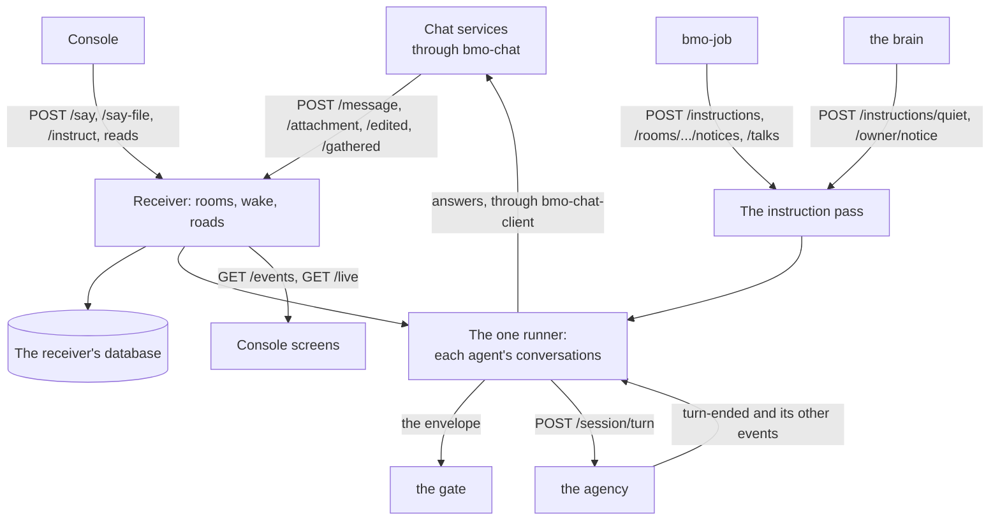

# The receiver

What the receiver is, what it carries, and how it stands among the units around it.

## Where it stands

- **One receiver.** It stands where its configuration names its database, the owner and the chat agent; without
  the owner it stands no receiver and says so on its output.
- **What it carries:**
  - the judgement of a message: whether the room is listened to; the owner's commands (allow, shut, pictures,
    delegation, mute, the two notices, the mode) with their acknowledgements queued as voiced notices; the
    message kept with the room's title; an agent's own words and a message already read stopped there; an edit
    written in place;
  - the wake: which designated agents of the room a message wakes, by the one rule (`docs/wake.md`), with
    everything that stops a message before it:
    - the owner's answer to a job's open question in the owner's private chat, handed to bmo-job;
    - the rest's gate, read off the agency's rest (`GET /rest`, and `GET /stand-in` for a road the rest closes);
    - the read mark, the reply mode, a mute, and whether a room rule names the sender;
    - the window each agent keeps in the room, and the one a call opens for a companion;
    - the files a person posted just before the words of theirs that woke the chat agent;
  - the conversations (`docs/wake.md`, `docs/bmo-window.md`): each room's queue, rounds, window and waits, the
    round's turn on the agent's session with the words pushed into it, the answer sent on the road the turn
    answers on with the room shown typing meanwhile, the fold, the failure orders and the cache warmer's touch;
    each answer sent is handed back to the receiver like any word filed in the room;
  - the instruction pass over every agent's rows (`docs/bmo-window.md`, 「The agent's queue」): each row handed to
    its room's conversation on the tick and at once where a row was queued, cold wakes paced, the rows that ride
    a round handed to it as it starts, and, as the receiver starts, every row a stopped round left handed and
    unsettled made pending again;
  - the restart (`docs/voiced-notices.md`, 「Deploy and restart」): a rest lifted past its end, every room but the
    owner's read up to its latest message and the owner told where it was a limit's rest; and, as the receiver
    starts, the owner's back notice with the deployment's purpose, then the words a restart left unread handed to
    the rooms where they wake an agent;
  - the console's talks about an item and a document (`POST /talks`), each turn a round of the owner's chat on the
    chat agent's session;
  - the one runner: each woken agent's turns in its conversations, the chat agent's and every companion's alike,
    every agent's rows of the instruction pass, and the words the room sessions left untaken taken up as the
    receiver starts, each answer handed back to the receiver like any word filed in the room;
  - the console's road in: `POST /say` into the owner's private chat and the rooms the console made;
  - the words' form of its own sends: the scaffolding guard, the sanitiser's pass unless the words come already
    read, under the label the send names where the text is no message, the dash net, and the words handed to the
    room's chat service in the form its dialect reads; refused where nothing but scaffolding is left;
  - the going-down line said to the owner as it stops (`docs/voiced-notices.md`, 「System notices」);
  - the event stream and the live board (「The event stream」 below).
- **What it does not carry:** a chat service's platform (its reading, its sending, its gathering of files and its
  numbering are the chat service's, behind bmo-chat), the agent sessions and their stand-ins (the agency's), the
  gate stage (the gate's), the memories, reminders, watches and digests (the brain's), the job queue (bmo-job's),
  the accounts and grants (the web unit's), the voice (the voice unit's), and the keepalive pass (the cache
  warmer's).
- **A woken agent's turn is its conversations' own:** the message goes into its room's queue with the files
  leading up to it ahead of it, opening the window where its ground does. A turn the rest's gate closed is taken
  only where the agent is pinned to a provider the rest does not close, or a stand-in answers on its road. A
  message read through somebody else's account, or by a read mode its chat service declares answers cannot be
  pinned to, goes in as read through a reader, so no answer is aimed at it. The owner's words from the screen go
  into the owner's conversation the same way, opening nothing.
- **Another unit reaches the conversations through the instruction pass alone:** a row it queues is delivered as
  any is.

## The one hard rule

- **A chat service's key may be stored, logged, shown and looked up. It may never be compared to a literal.**
- Allowed: kept on a message row, written to the log, shown on a console screen, handed to bmo-chat-client to reach
  that service.
- Forbidden: a comparison against any service's key anywhere in the receiver, and equally a chat-number range test
  or a message id sign test standing in for one.
- **Every difference is asked of the declaration instead** (`GET /declaration` and the room routes): the
  capabilities, the read modes, the dialect, the numbering, who the agent is in this room, whether this room is
  the owner's private chat, and whose one-to-one with the agent it is.
- The reason is the cost of the next chat service. A comparison to a literal is a branch somebody has to find and
  extend; a question asked of the declaration answers itself for a service that did not exist when the question
  was written.

## The owner's words

- **`POST /say` and `POST /say-file` put the owner's words into a room from the console.**
  - In the owner's private chat the words reach no other service: they are archived under a console number and
    handed to that chat's conversation (`docs/unified-bmo.md`, 「Console conversation in the private chat」).
  - In a room the console made the same holds.
  - In any other room they go as the owner, on the road the room's chat service declares for the owner's voice,
    so the room receives them as it receives anything the owner types there and the agent answers in the room.
  - A `replyTo` names the archived message the words answer; one the archive does not hold is refused 409 and
    nothing is sent.
  - Files go each as its own message where the road takes them that way, as albums where it takes those, the
    caption on the first; a file past the road's ceiling is refused 413, and a call none of whose files went
    answers as one refusal.
- **`POST /instruct` says the owner's words to a room's session**, framed as the owner speaking from the console,
  delivered as a quiet instruction, so the room sees nothing but the answer it leads to; a chat the archive has
  never seen is refused.

## The event stream

- **The frames of `GET /events`:**
  - `event: run` first, naming the stream's run, the moment the receiver's process started. A cursor is read only
    against the run it was taken in; one from another run, or one naming no run, is handed the whole ring;
  - each event as `id: <n>`, `event: bot` and its JSON, out of a ring of the last 500, replayed after the cursor;
  - `event: live` with the picture as it stands, after the replay and with no id;
  - `: ping` every fifteen seconds;
  - `event: stopping` with no id when the receiver stops on purpose, after which the stream ends.
- **What goes into it** is the news the receiver makes itself: a message it kept or wrote again, a window opened
  or restarted, a room whose registration was removed as `room-removed` with its number, the picture whenever it
  changes, and what `POST /event` says (a message or a briefing checked against the archive first, the profile
  pictures a chat service took).
- **The picture (`GET /live`) is drawn of what the receiver runs itself:** the chat turns of its conversations and
  companions, the rooms whose session it is folding and the message each room queued for a turn, the picture going
  out again as each of them begins, moves or ends. With none of them standing, it is empty.
- **`GET /health` answers for the receiver itself:** `ok`, the owner, `bot` with this process's number and the
  moment it started, and its version. A deployment's wait matches `bot`'s number against the unit's main process.

## Removing a room's registration

- **The administrator removes a room's registration** through `GET /rooms/remove`, which answers what would go,
  and `POST /rooms/remove`, which takes it. Both refuse anyone but the administrator (`GET /users/{user}` on the web
  unit). No other act or chat service's event removes a room.
- **What goes is the room's whole record in the receiver:** every row of every receiver table holding the room's
  number in a `chat_id` column, the tables read off the database's own schema as the removal runs rather than off
  any list (its registration and title, its switches and answerers, its messages, its reads, its collected-file
  rows, its draws); what an owner of room state outside those columns declares beside its own code (its picture,
  the settings that name it, what its runs wrote down, and its folders in the message-file store, the picture store
  and the outboxes, `docs/room-files.md`).
- **Every other unit's part goes through that unit:** the agency forgets the room (`POST /rooms/forget`), the brain
  removes its rows and folders (`POST /rooms/removed`), and every declared holder (`PUT /room-holders/{unit}`) is
  asked what it holds (`GET <address>/rooms/{chat}/holdings`): what it keeps stays and keeps the room's chat, what
  it warns of is shown in the confirmation.
- **What stays is work filed from the room, and accounting:** its items, jobs, job questions and searches, each
  keeping the room's number as where it came from, the log lines of a job's turns, and the usage of every run
  there. Each table or row of the receiver's that outlives its room says so in a declaration beside the code that
  writes it, and the tests fail on any column holding a room's number that the removal neither sweeps nor finds
  declared.
- **A setting that names a room is made only through a declaration** whose prefix and shape build its key from the
  room's number, and the removal takes every key a declaration matches. Any other setting whose key holds the
  room's number as one of its parts is listed in the confirmation as undeclared and kept: a private chat's number
  may be its person's number too.
- **Some rooms are refused,** with the reason and nothing written: a room the companion seeds declare, which the
  next start would make again; the infrastructure room the configuration names; and the administrator's own
  private chat on any road. Each refusal is declared by the code that depends on the room, not kept in one list.
- **The confirmation lists what goes and what stays before anything is taken,** with a count for each table, the
  folders with their files and every holder's answer, and it warns: of each companion answering the room, which
  stays with this room no longer to answer in; of open items and job questions filed from the room; of another
  user's private chat, naming the user; of a road that can still reach the room, where a later message would make
  it anew.
- **Once begun it runs to its end,** whatever becomes of the request that asked for it: open turns in the room are
  cut and its sessions ended through the agency; every holder of live per-room state forgets the room (every
  agent's conversation there with its timer, its queue and its window, and the receiver's caches kept by room);
  the rows go in one write; once that write stands, the picture and the folders go; and the event stream carries
  one `room-removed` event naming the room.
- **Kept work whose room is gone reaches the administrator instead:** bmo-job reads a room whose registration is
  gone as working in the owner's private chat (`GET /rooms/{chat}`, `work_chat`), and an instruction queued for
  such a room, a run's ending among them, goes to the owner's private chat naming the room it came from
  (`docs/boundary-api.md`, 「For bmo-job」).
- **A room that speaks again afterwards is a new registration** with an empty record, answered as any room the
  receiver has never seen, numbered as its chat service numbers a room. None of the old record comes back.

## Identity, and reaching the owner

- **Who the agent is differs per room,** so it is asked per room (`POST /room/identity`). A chat service where the
  agent holds an ordinary account has the agent's own words under an ordinary sender number, and a receiver that
  derived the agent's identity from one service's token would count its own words as unread and fail to recognise a
  reply to itself.
- **Whether a room is the owner's private chat is a chat service's question** (`POST /room/is-owner`), not a
  comparison against the owner's number on one service.
- **Whose one-to-one with the agent a room is, is a chat service's question too** (`POST /room/private-of`). The
  receiver turns the answer into a user's private chat only where that person's sender is linked to a user
  (`docs/wake.md`, 「Who reaches the session」); a one-to-one with somebody linked to no user is an ordinary room.
- **In a room the console made, the agent and each companion have numbers of the console's own,** given as the
  rooms are stood up (`POST /companions/add`), and a companion's words are filed under the number it was given and
  under its name, so one room holds both speakers apart.
- **Reaching the owner without naming a transport** (the login notice, the restart notice, the rest notice) is
  asking each chat service for the owner's room (`GET /owner-room`): the first of the rooms whose record is shown,
  kept in that record, and otherwise the first chat service reaching the owner on its own, on that service.
