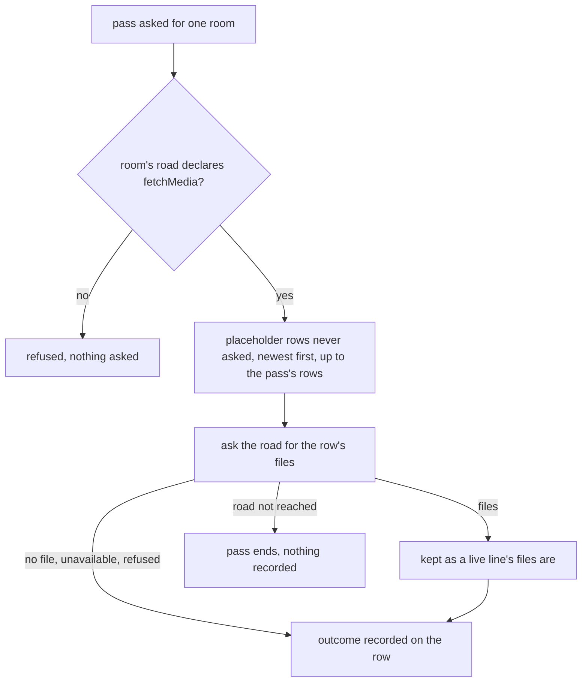

# A room's files stay in that room

What a room posted, and what an agent keeps or made for it, is that room's. It never goes into another room as a
check, a test or an example, and a job never sends it at all. This document also holds how the message-file store
keeps what a message carried and whom a kept file wakes, and the tools that put a kept file back.

## The stores that keep files by room

- **Three stores under the data root keep a folder per room**, named by the room's chat id:
  - the message-file store (`collected/`), every file a message carried, the voice briefings included;
  - the picture store (`images/`), the pictures read off a room's messages;
  - the outboxes (`outbox/`), the files an agent made for a room and has not sent yet.
- **A file in one of those folders belongs to that room**, whoever's room it is: the owner's private chat is a
  room like any other, and its files do not go into a group room either.
- **The folders live as long as the room's registration.** Each store declares its folder as the room's, and the
  three go only with the administrator's removal of the room's registration, together with the room's rows of
  kept files (`docs/receiver.md`, 「Removing a room's registration」). No chat service's event, agent's removal
  or clean-up takes them.

## Message files

- **Voice notes, ordinary audio, videos, animations, stickers and documents are kept from every sender** in allowed rooms, silently and
  whatever their size, in the message-file store: the `collected_items` table and the files
  under `collected/<chatId>/` of the data root. Keeping a file launches nothing and notifies nobody.
- **The bytes come from the chat service:** with the hand-over, or later as the message's `gathering` promised,
  or asked of the service again on its route of a message's files (bmo-chat's `docs/protocol.md`): for a
  replied-to picture (`docs/pictures.md`, 「Whether an agent looks」) and for a row filled in later (「Files filled
  in later」).
- **A file a chat service carries as a part arrives on the disk:** the base library writes it, as its bytes come,
  into the spool, the folder `.spool/` in the message-file store, whether it comes with a hand-over, with a
  gathering's patch or in the answer of a fetch of a message's files (bmo-chat's `docs/contract.md`, 「A file's
  bytes」). Filing it links it under its message, so it is moved rather than copied: the store and the spool stand
  on one disk, and the spool's name for the file goes once the receiver has done with it. Until then it stays
  readable where it arrived, for the hearing of a voice note and for the room's other providers it is carried to.
  A file a chat service hands over inline is written from memory.
- **A file an agent sent is kept from the send itself.** The bytes a send hands over — a file send's document
  or album, a sound, a voice note — are filed under the message the send is kept as, the way a received file
  is: a picture in the picture store (`docs/pictures.md`, 「A picture an agent sent」),
  anything else here, by its own name, a voice note under the name a sound with none takes. A file a send took
  from where it stands on this machine is copied here, since that file is still its sender's to change. A file
  the road said did not go is left out, and keeping never fails a send: the file is already in the room by the
  time it runs, so a file that could not be kept is said in the journal.
- **Every file is recorded in `collected_items`** (chat, sender, message id, kind, source, stored path, and the
  file's id among its message's files) and keeping the same file twice is a no-op.
- **Twice means the same file.** Every file a message carried crosses as a message file, with an id the chat
  service gives it: the same each time the same file crosses, and never shared by two files of one message
  (bmo-chat's `docs/contract.md`, 「Files」). A file is the message's file of its id: where its row stands and its
  bytes are still on the disk, a hand-over or a fetch of it again keeps nothing. Two files of one name in one
  message are two files, each with its row. A row that names no id is the message's file of its name, and the
  first file of that name handed over takes the row and records its id on it.
- **Where a file is filed:** under `collected/<chatId>/` as `<messageId>-<name>`, by its own name's last part, or
  as `<messageId>-<n>-<name>`, from 2 up, where another file of the message already stands under that name.
- **A file the console uploads is filed from the disk,** not from memory: the form's file was written under
  `incoming/` as it arrived (`docs/store.md`, 「The data root's folders」), and is filed by a link to those bytes,
  or a copy where the message-file store stands on another disk. A picture among them is read to be drawn as any
  picture is.
- **Failures:** a file that could not be written keeps its row with no stored path and why,
  and a later hand-over of the same file keeps it; a failure is logged but never takes the receiver down.
- **A row's kind is what the file is:** `sticker` for a file the chat service hands over as a sticker and
  `animation` for one it hands over as an animation (bmo-chat's `docs/contract.md`, 「Files」), where the file is no
  picture; otherwise its type's, `audio`, `video` or `document`. A picture a sticker or an animation came as is
  filed in the picture store, as it came where it moves, and a sticker's message is marked a sticker
  (`docs/pictures.md`, 「Pictures received」). A row kept before the chat service's kind was read takes `sticker`
  where its file is named as a sticker, `sticker-` at the head of its name.
- **A video or an animation with no file name of its own** is filed as `video` with the extension its type
  implies, and a sound with none as `voice` with its own (`policy/roads.toml`, `gathering`).
- **What is kept always has a message to hang on.** A voice note, an audio file and a document are written into
  the archive as the short placeholder line the chat service makes of it, so the room reads back with the note in
  its place and the console has a row to put a listen button on.

### What the console reads of them

- **The console plays, opens and saves a message's files through the receiver** (`docs/boundary-api.md`, 「A
  message's files and picture」): it lists them in the order a page's files stand, each by its place among them,
  and asks for one's bytes by that place, never by a path.
- **Only bytes inside the room's own folder go out.** A stored path is followed through its links first and served
  only where it resolves inside the room's folder of the message-file store; a row with no stored path, or one
  that points anywhere else or at nothing left on the disk, is answered as nothing held.

### Who a file wakes

- **Most files wake nobody:** a voice note is not something a session can hear, and waking one for every note in a
  busy room would be paid for and answer nothing, so the next turn reads the line out of the archived block like
  any other.
- **A file is held to the same grounds as words** (`docs/wake.md`, 「Who reaches the session」), its caption
  read as its words: a caption that calls the agent by name, a reply to a message of the agent's own, the room's
  open window, or a private chat that needs no name, the owner's file in the owner's own chat among them. What
  passes is routed once the file is kept, and the session is never woken ahead of the bytes.
  - A person an active room rule names is no ground by itself: their file with no calling caption in a group
    whose window is closed wakes nobody, like anyone's. Their text is text like anyone's too. The room's rules
    are `rule` memories in the agent's brain, applied by the gate within a turn the grounds opened.
- **A file that woke nobody rides the request that follows it.** When somebody other than the owner posts a file
  and then, within two minutes of it (the wake policy's `file_lead_seconds`, looked for among the room's latest
  `file_lead_messages`), says something of their own that wakes the agent (a call, a reply to the agent, or
  words inside its open window), the receiver hands the agent that person's files from those two minutes first,
  in their order, so the turn that reads the request reads the files beside it, each with its note. A file still
  being fetched when the request arrives goes in without a note, and a file a turn already read is not read
  again by the same conversation.
- **The note beside the message.** Whenever a session is shown such a message it carries a note beside it for
  every thing it carried: a file (`[attached file job.wav saved at <path>]`, or `was not stored` when keeping it
  failed) read from the message's `collected_items` rows, a picture's stored path or its not-stored line, a voice
  note's transcript or the line saying it could not be heard, and a sticker's picture. A message with no caption
  is not an empty line: its words stand empty and its notes follow them. The note is written from the message as
  it stands after the file is kept and heard, never from the hand-over that came before either, so a path or a
  transcript is always the one the room holds. A message that truly carried nothing stays as it is, with no note
  invented for it.
- **What a room rule asks to be done with the file** is the session's to carry out with a tool: the rule is free
  text the owner can revoke, and a revoked rule stops the action with it.

## Files filled in later

A chat service may hand a message over with only the words it writes for a file it did not carry, and come to
carry such files later (bmo-chat's `docs/contract.md`, 「Files」). Such a row stands in the room as bare text until
its files are asked for again.

- **Which rows a pass asks for:** a message of the room whose words are one of the placeholder heads of
  `policy/roads.toml` (`[filling]`, `heads`), or open with one followed by a space or a line break; with no
  picture on its row and no row in `collected_items`; not deleted; and never asked before. The heads are data
  the chat services' placeholder words are matched on, never read as one service's.
- **Only a room whose road declares `fetchMedia` is filled.** A room no road holds, or whose road declares no
  `fetchMedia`, is refused before anything is asked.
- **Each row is asked by its room, its number and its sent time,** one row at a time, the newest first, so a
  file still on the platform's side is reached before it expires.
- **What comes back is kept as a live line's files are** (「Message files」; `docs/pictures.md`, 「Pictures
  received」): the first picture under the message in the picture store with its path on the row and its picture
  state `stored`, an album's later pictures beside it, and every other file in the message-file store with its
  row. The row's words are left as they stand. The console reads the row through its usual routes, so it draws
  the picture and lists the files with nothing more.
- **Each row is asked once.** What the road answered is recorded in `message_file_asks`, by room and message:
  `filled` with how many files were kept and their bytes, `none` where the road answered no file, `unavailable`
  where the platform would not give them, `refused` for any other refusal, with the road's own sentence. A pass
  never asks a recorded row again. A road that could not be reached at all records nothing and ends the pass
  there, so a later pass asks the same rows.
- **A pass is bounded and started by hand:** `POST /rooms/{roomId}/file-fills` (`docs/api.md`, 「Messages」), or
  the unit command's `room fill-files` (`docs/boundary-api.md`, 「The unit command」). It asks at most `rows` rows
  of one room, `default_rows` where none is named and never more than `most_rows` (`policy/roads.toml`,
  `[filling]`); `dryRun` lists the rows it would ask and asks nothing. One pass runs in a room at a time, and a
  second asked while one runs is refused. Nothing starts a pass on its own.
- **The answer names every row the pass reached:** its number, its sent time, what the road answered and why,
  and each file kept with its kind and bytes.

## Tools that take a path

- **Which:** a picture named by a kept file (`bmo room photo`, and the send tool's `photo` entry).
- **A file in another room's folder is refused** before anything is sent, for every caller: the refusal names the
  room the file is kept for.
- **A file in the sending room's own folder goes**, and so does a file outside every store: a web copy a search
  made, a picture drawn for the send.
- **Links are followed first**, so a link made elsewhere that points into a room's folder is that room's file.

## Tools that take a message

- **Which:** `bmo room file`. It sends the file kept for one message, back into that message's room or on to the
  owner's private chat, and nowhere else.
- **The owner asking for a room's file is what it is for**, so a chat session's send on to the owner's chat
  stands; a job's does not (「A job's sends」).

### A file back

- **A file somebody posted, put back as the agent's own message,** through
  `bmo room file --chat <chatId> --message <messageId> [--to <ownerId>]`.
- **It is given a message and never a path:** it takes the file kept for that message from `collected_items`, and
  refuses, sending nothing, when nothing is kept, when the kept path does not resolve inside the message-file
  store's directory, or when the file is larger than the room's chat service takes.
- **It runs in the caller's own process,** since an upload is quick: the document sent as a reply to the original
  (or to the owner's chat with `--to`), the message archived under the agent's name with its reply, and a copy of
  the file kept under `collected/` for that message with the original name as its source, so the console stands
  it like a received file.

## A job's sends

- **A job sends no file any room's folder holds**, not even into that same room: a job's send is a check, and a
  check is made of material the job made itself: a short line it synthesised, a picture it drew, a file it wrote
  for the check. Every tool above refuses a job's send of a room's file, and the refusal says what to make
  instead.
- **What a job is:** the asker's `job` mark on `POST /sends`, which the job's own tools set.
- **Where the job's check goes** is the room the item names for trying a send, and nowhere else.
- **What no tool can see:** bytes copied out of a room's folder into a new file, or read out of the archive, are no
  longer a room's path. That is the rule every job reads in its instructions, and not a refusal: a job never takes
  a room's file, message or archived words as test material, whatever road it goes by.
